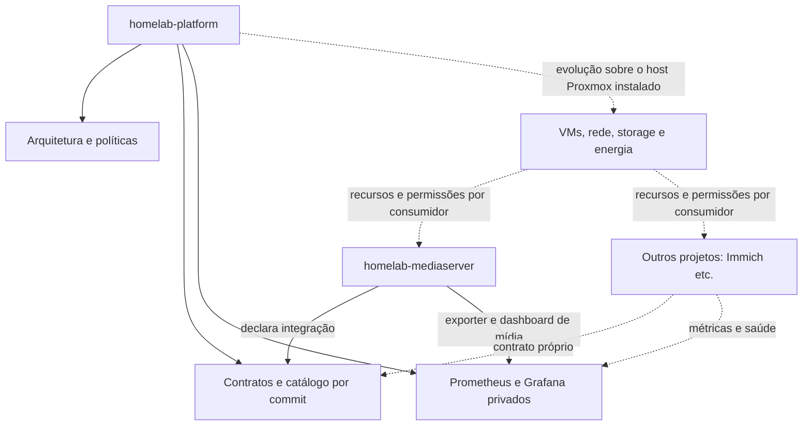

# Homelab Platform

Infraestrutura compartilhada do homelab: arquitetura, contratos de integração,
catálogo de projetos e observabilidade. Este repositório concentra as decisões
de compute, redes, armazenamento, acessos e energia. As aplicações mantêm seus
próprios repositórios e entregam os manifests e as integrações que consomem essa
infraestrutura.

**Estado: host Proxmox instalado e acesso privado verificado.** A instalação
foi realizada pelo proprietário; SSH e HTTPS foram conferidos em 15/11/2026.
VMs, restauração, firewall, hub NFS e serviços continuam pendentes. Prometheus/
Grafana e o validador local estão preparados na branch `refactor`; K3s é futuro.
Publicar estes arquivos não aplica a topologia ao servidor.



## Documentação

| Guia | Conteúdo |
|---|---|
| [Arquitetura](docs/architecture/README.md) | As-is, to-be, diagramas, segurança, gaps e decisões do proprietário |
| [Responsabilidade dos repositórios](docs/repositories.md) | Plataforma, consumidores, versões e autoridade operacional |
| [Contrato de integração](docs/integration-contract.md) | Recursos, rede, storage, telemetria, segredos e recuperação |
| [Observabilidade](docs/observability.md) | Grafana/Prometheus, alvos opt-in, diretórios e limites |
| [Estado da implementação](docs/implementation-status.md) | O que existe no código e o que falta comprovar no servidor |
| [Proxmox](infrastructure/proxmox/README.md) | Host entregue e escopo das VMs e do isolamento pendentes |
| [Instalação assistida](docs/runbooks/proxmox-installation-handoff.md) | Histórico da preparação, instalação e reconexão privada verificada |
| [K3s](infrastructure/k3s/README.md) | Entrada posterior e fronteira com o hipervisor |

O [repositório de mídia](https://github.com/reisguilherme/homelab-mediaserver/tree/refactor)
mantém Jellyfin, Arr, qBittorrent, controlador, recuperação da aplicação,
exporter e dashboard de mídia. Immich e outros projetos terão seus próprios
contratos; não estão instalados por este repositório.

## Validação local

Use Python 3.12 em Linux/WSL2 e `uv`:

```bash
uv sync --frozen
uv run make lint
uv run make test
uv run make validate
uv run python scripts/validate.py service /caminho/do/projeto/platform.contract.json
```

O validador é local, não consulta a rede, não concede acesso e não executa
deploy. O [catálogo](catalog/services.json) exige commits imutáveis e distingue
propostas de implantações. Uma entrada válida não demonstra que seu manifest
aplica todas as políticas; essa revisão e o aceite de runtime são separados.

## Integração de um projeto

1. Criar o contrato a partir de [templates/service.contract.json](templates/service.contract.json),
   por unidade de implantação e fronteira de confiança. Um projeto pode ter
   vários contratos; cada container não precisa virar outro repositório.
2. Fixar o commit da plataforma que fornece o schema e os guias utilizados.
   Manter valores de segredos no `.env` privado da implantação.
3. Validar o contrato, revisar manifests e registrar o commit do projeto no
   catálogo como `proposed`.
4. Provisionar recursos/permissões e testar acesso, recuperação e rollback em
   janela autorizada. Só então registrar o aceite e o estado `deployed`.

O primeiro consumidor é a integração privada de métricas do projeto de mídia.
As unidades futuras de core e playback precisam de manifests segregados antes
de declarar conformidade com o isolamento proposto.

## Limites operacionais

Não há automação de instalação do hipervisor, CI/CD, gerenciador de backups,
releases próprias ou units do host. As instruções de observabilidade são opt-in.
O proprietário autorizou indisponibilidade. O checkpoint anterior de mídia
teve retorno dos serviços; a captura final ampliada foi selada, então com os 22
containers antes ativos parados e SSH disponível. Depois do desligamento,
o proprietário instalou Proxmox somente no SSD autorizado. A entrega do host
identificado e acessível por SSH/HTTPS está concluída, conforme o
[estado de implementação](docs/implementation-status.md#host-proxmox-entregue).
A captura final tem checksums conferidos no HD de 18 TB. O proprietário
decidiu prosseguir com essa única cópia completa: a transferência Windows foi
interrompida e está incompleta; novo ensaio integral não é pré-requisito para
instalar. O segundo SSD mantém o UUID ext4 anterior e está desmontado; os HDs
USB permanecem desconectados. Ainda não foram criadas VMs ou retomados serviços,
e não há regras de firewall configuradas. A inicialização
isolada da mídia já foi examinada, com os limites do [registro de implementação](docs/implementation-status.md).
Disco único, USB e hub único continuam pontos de falha; adquirir
o nobreak e ensaiar recuperação são pendências do desenho.
