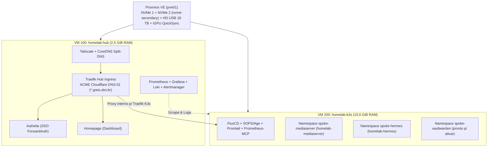

# homelab-platform (HUB)

Infraestrutura compartilhada do **HomeServer** no modelo **Hub & Spoke**, construída sobre **Proxmox VE + OpenTofu + Ansible + Traefik + Authelia + Prometheus/Grafana/Loki + K3s + FluxCD + SOPS/Age**.

> [!NOTE]
> O estado anterior ao refactor (`6641556`) foi preservado na branch/tag `archive/legacy-2026-11`. A branch `main` contém exclusivamente a arquitetura declarativa limpa.

## Arquitetura Geral



## Estrutura do Repositório

| Diretório | Responsabilidade |
|---|---|
| `infrastructure/proxmox/` | OpenTofu: VMs `100` e `200`, firewall do host e das VMs, passthrough USB/iGPU e backups `vzdump` no `nvme-secondary`. |
| `infrastructure/ansible/` | Playbooks Ansible: bootstrap da `homelab-hub`, mounts UUID com `RequiresMountsFor`, K3s e FluxCD + SOPS/Age. |
| `infrastructure/hub/` | Docker Compose da `VM 100`: Traefik, CoreDNS, Authelia, Homepage, Prometheus, Loki, Alertmanager e Grafana. |
| `kubernetes/clusters/homelab/` | Entrypoints raiz do FluxCD (`platform` + `spokes-registry`) com descriptografia `SOPS/Age`. |
| `kubernetes/platform/` | Namespaces de plataforma, `promtail`, `kube-state-metrics` e `prometheus-mcp` (somente leitura para o Hermes). |
| `kubernetes/spokes-registry/` | Registro declarativo dos Spokes (`mediaserver`, `hermes` e `vaultwarden` pronto para ativação). |
| `kubernetes/templates/spoke-starter/` | Template padrão (**Spoke Factory**) para criar novos Spokes em minutos. |
| `docs/` | ADRs arquiteturais (`docs/adr/`) e o roteiro de virada assistida (`docs/cutover-runbook.md`). |

## Validação Local

Requer Node.js (`>= 20`) e `kubectl` (`>= 1.30`, com `kustomize` embutido):

```bash
node scripts/validate.mjs
```

Para validar sintaxe OpenTofu localmente quando `tofu` estiver instalado:

```bash
tofu -chdir=infrastructure/proxmox init -backend=false
tofu -chdir=infrastructure/proxmox validate
```
