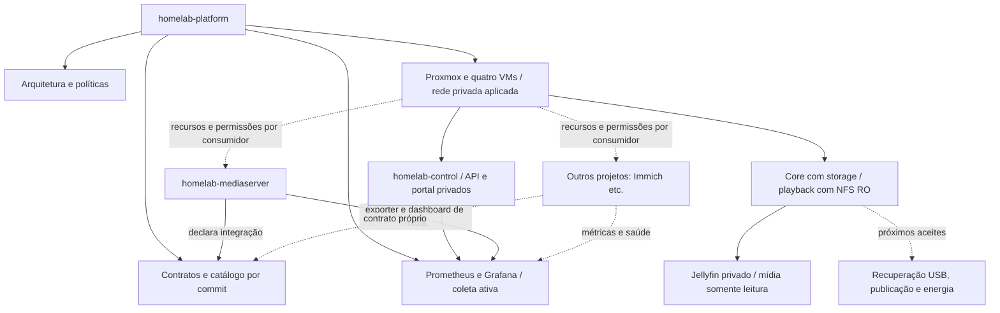

# Homelab Platform

Infraestrutura compartilhada do homelab: API e portal de governança, arquitetura,
contratos de integração, catálogo de projetos e observabilidade. Este repositório concentra as decisões
de compute, redes, armazenamento, acessos e energia. As aplicações mantêm seus
próprios repositórios e entregam os manifests e as integrações que consomem essa
infraestrutura.

**Estado: host Proxmox, três VMs de mídia e uma VM de governança.** Core,
playback e edge têm QGA, SSH e NTP conferidos. A bridge de gestão foi preservada;
NAT sem DNAT e filtros dos convidados passaram pelos testes TCP e de pacotes
registrados. O reboot confirmou autostart ordenado, acesso e persistência dos
filtros. O HD de 18 TB pertence exclusivamente ao core; playback já lê mídia
por NFS RO, com escrita negada em fixture. Docker e a imagem Jellyfin 12.2
foram instalados na playback, com configuração e cache restaurados e
conferidos. Jellyfin iniciou saudável; API autenticada, preservação do catálogo,
leitura HTTP e decodificação por CPU passaram. O reboot da playback confirmou
retorno automático do NFS RO, Docker e Jellyfin no perfil inicial. Depois,
transcode recebeu SSD virtual dedicado de 32 GiB, mantendo 3 GiB de RAM no
container; um encode curto por CPU passou. As 18 senhas foram redefinidas e
testadas por login/logout, com a relação somente no Windows privado. A lease
obrigatória está implantada, com expiração, HOLD e pausa manual testados.
Reboot com SSD/lease passou, recusando a lease anterior. Readmissão exige ação explícita e
prova nova; reboot do Proxmox pede auditoria do estado, sem promessa de retorno
integral desassistido. Recuperação
USB e publicação continuam pendentes; a automação de mídia permanece parada.
Homelab-control já tem 2 vCPU, 2 GiB, SSD virtual de 24 GiB, QGA/SSH e nginx
TLS. O core foi reduzido de 6 para 4 GiB após medição e parada limpa, mantendo
11 GiB totais para os quatro guests. Exporters estão instalados nos quatro
convidados. **API, portal, Prometheus e Grafana estão implantados com acesso
privado por TLS.** CRUD, recursos, ACL, idempotência, negações de acesso e TOTP
passaram em ensaios reais com contas e VM descartáveis. Os seis alvos de coleta
estão ativos; 25 painéis foram provisionados (22 com revisão visual anterior) e alertas de perda de fontes
dispararam e resolveram no teste. O reboot do controle preservou auditoria,
Grafana e coleta, invalidando a sessão anterior. Portal e dashboards passaram
no navegador real, em desktop e mobile; não há alerta ativo na observação final.
ACPI via API em guest com SO e manutenção horária da auditoria SQLite também
foram aceitos. O coletor de playback agora distingue saúde Jellyfin, admissão de
storage e frescor; seu alerta de coleta obsoleta disparou e resolveu em ensaio.
A correção da tampa passou no teste físico de 30 segundos. O retorno USB foi
assistido; recuperação automática continua pendente. Os três discos de origem
estão em inspeção RO sem replay do journal. Docker foi instalado no core, ainda
sem aplicações readmitidas. A prioridade é [core e consolidação](docs/architecture/operational-priorities-2026-11-16.md).
K3s é futuro. O [estado canônico](docs/implementation-status.md#continuidade-operacional-de-1611)
registra o alcance das provas e os limites de operação.
O [gerador de bootstrap](scripts/proxmox_bootstrap.py) produz um bundle offline,
sem deploy; publicar arquivos não aplica alterações ao servidor.



## Documentação

| Guia | Conteúdo |
|---|---|
| [Arquitetura](docs/architecture/README.md) | As-is, to-be, diagramas, segurança, gaps e decisões do proprietário |
| [Responsabilidade dos repositórios](docs/repositories.md) | Plataforma, consumidores, versões e autoridade operacional |
| [Contrato de integração](docs/integration-contract.md) | Recursos, rede, storage, telemetria, segredos e recuperação |
| [Observabilidade](docs/observability.md) | Grafana/Prometheus, alvos opt-in, diretórios e limites |
| [Domínios greis.dev.br](docs/architecture/access-domains.md) | Streaming público e administração privada; desenho ainda sem DNS/TLS aplicados |
| [Prioridades atuais](docs/architecture/operational-priorities-2026-11-16.md) | Core/acervo primeiro; discos, controles por serviço, UI e RAM registrados |
| [Estado da implementação](docs/implementation-status.md) | O que existe no código e o que falta comprovar no servidor |
| [Proxmox](infrastructure/proxmox/README.md) | Host, convidados e limites atuais de rede |
| [Instalação assistida](docs/runbooks/proxmox-installation-handoff.md) | Histórico da preparação, instalação e reconexão privada verificada |
| [VMs e rede privada](docs/runbooks/proxmox-guests.md) | Estado real, testes, geração offline, preflight e aplicação controlada |
| [Storage no core](docs/runbooks/storage-core-handoff.md) | Identidade do HD, mount preservado e NFS RO para playback; alcance dos testes |
| [Jellyfin na playback](docs/implementation-status.md#jellyfin-na-playback) | Restauração selecionada, isolamento, aceites e limites da aplicação |
| [Governança privada](docs/runbooks/platform-governance.md) | API/portal implantados, operações reais verificadas e limites de administração |
| [K3s](infrastructure/k3s/README.md) | Entrada posterior e fronteira com o hipervisor |

O [repositório de mídia](https://github.com/reisguilherme/homelab-mediaserver/tree/refactor)
mantém Jellyfin, Arr, qBittorrent, controlador, recuperação da aplicação,
exporter e dashboard de mídia. Immich e outros projetos terão seus próprios
contratos; não estão instalados por este repositório.

## Validação local

Use Python 3.12 em Linux/WSL2 e `uv`:

```bash
uv sync --frozen
uv run make lint
uv run make test
uv run make validate
uv run python scripts/validate.py service /caminho/do/projeto/platform.contract.json
```

O validador é local, não consulta a rede, não concede acesso e não executa
deploy. O [catálogo](catalog/services.json) exige commits imutáveis e distingue
propostas de implantações. Uma entrada válida não demonstra que seu manifest
aplica todas as políticas; essa revisão e o aceite de runtime são separados.

## Integração de um projeto

1. Criar o contrato a partir de [templates/service.contract.json](templates/service.contract.json),
   por unidade de implantação e fronteira de confiança. Um projeto pode ter
   vários contratos; cada container não precisa virar outro repositório.
2. Fixar o commit da plataforma que fornece o schema e os guias utilizados.
   Manter valores de segredos no `.env` privado da implantação.
3. Validar o contrato, revisar manifests e registrar o commit do projeto no
   catálogo como `proposed`.
4. Provisionar recursos/permissões e testar acesso, recuperação e rollback em
   janela autorizada. Só então registrar o aceite e o estado `deployed`.

O primeiro contrato publicado foi a integração privada de métricas do projeto
de mídia. A playback tem um contrato e Compose próprios no repositório
consumidor; a automação do core ainda precisa da sua unidade segregada. O
catálogo e o registro de runtime distinguem preparação e execução aceita.

## Limites operacionais

Não há automação de instalação do hipervisor, CI/CD, gerenciador de backups,
releases próprias ou units do host. As instruções de observabilidade são opt-in.
O proprietário autorizou indisponibilidade. O checkpoint anterior de mídia
teve retorno dos serviços; a captura final ampliada foi selada, então com os 22
containers antes ativos parados e SSH disponível. Depois do desligamento,
o proprietário instalou Proxmox somente no SSD autorizado. A entrega do host
identificado e acessível por SSH/HTTPS está concluída, conforme o
[estado de implementação](docs/implementation-status.md#host-proxmox-entregue).
A captura final tem checksums conferidos no HD de 18 TB. O proprietário
decidiu prosseguir com essa única cópia completa: a transferência Windows foi
interrompida e está incompleta; novo ensaio integral não é pré-requisito para
instalar. O segundo SSD mantém o UUID ext4 anterior e está em inspeção RO sem replay. O HD
de 18 TB foi reconectado e entregue ao core, com exportação de mídia RO para
playback; o backup ficou fora do export. Docker e a imagem Jellyfin foram
instalados na playback, com restauração selecionada da configuração
e do cache. Jellyfin está saudável com catálogo e usuários preservados,
inclusive no reboot do perfil inicial. O transcode agora usa SSD dedicado;
seu retorno após reboot foi conferido com readmissão explícita. Não há GPU entregue aos convidados
nem automação de mídia iniciada. O firewall legado
dos convidados está ativo, mas o firewall do host mantém `enable: 0`; a
restrição da gestão na LAN continua pendente. A inicialização
isolada da mídia já foi examinada, com os limites do [registro de implementação](docs/implementation-status.md).
Disco único, USB e hub único continuam pontos de falha; adquirir
o nobreak e ensaiar recuperação são pendências do desenho.
