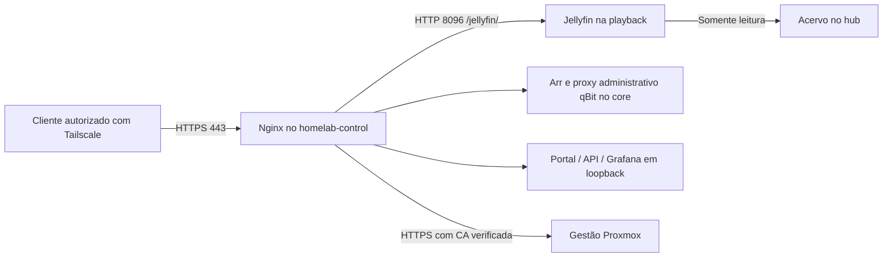

# Domínios e acesso ao homelab

## Desenho atual em 16/11/2026

O proprietário revogou a publicação WAN, VPS e a porta 10443. **Todos os nove
serviços passam a usar Tailscale**, inclusive Jellyfin em
`https://jellyfin.greis.dev.br/jellyfin/`. A raiz do novo hostname redireciona
para esse prefixo. O proprietário criou o registro A para o IP Tailscale do
controle; o wildcard Let's Encrypt privado existente cobre o nome.

Os oito nomes administrativos anteriores responderam HTTP 200 com certificado
válido localmente e pelo Windows/Tailscale, usando DNS normal. Sete checks
reais qBit passaram: API anônima 403, login/versão autenticados, Origin
incorreto 401 mesmo com Referer correto, sessão preservada e logout seguido
de 403. O nono vhost Jellyfin foi implantado e respondeu HTTP 200 com TLS
válido, inclusive por DNS normal no Windows/Tailscale. Logins comum e admin,
identidades, catálogo de vídeo, Range 206 de 64 KiB e WebSocket 101 com aceite
exato passaram. A conta comum recebeu 403 na rota administrativa; logout
revogou as duas sessões. O WebSocket usou `ApiKey` canônico, sem habilitar APIs
legadas. O bundle instalado usa `api_key` no socket e no download; uma adaptação
restrita no Nginx converte somente esses dois usos em Authorization moderna,
preservando a precedência de credenciais explícitas. WebSocket legado também
passou com 101 e aceite exato; download legado retornou 206 de 64 KiB.
Não há aceite de reprodução interativa completa em cliente pelo novo
nome. Console/upload Proxmox e negações por
usuário da tailnet continuam com aceites próprios.

Os três containers da entrada pública na edge estão parados e a conexão WAN
foi recusada. Dois DNAT ativos, quatro hooks persistentes e três exceções
dos guests foram removidos; firewall convergiu, preservando
controle/playback, SSH, NFS e masquerade. A antiga publicação não
deve voltar automaticamente por reinício de serviços ou roteiros históricos.
A VM edge (122) foi desligada de forma limpa e está `stopped`, com `onboot=0`;
discos e demais configurações permanecem preservados. Os nove domínios
mantiveram HTTP 200 e TLS válido pelo Windows/Tailscale após o desligamento;
nenhum desses acessos privados depende da edge.
O certificado público foi retirado de uso, com chaves preservadas privadamente
e métrica de validade desativada. O certificado privado continua monitorado:
aviso abaixo de 21 dias e crítico abaixo de 7, por 5 minutos, somente no painel.

DNS permanece no Registro.br em modo avançado. **A renovação DNS-01 do
certificado privado ainda exige intervenção.** DDNS residencial não é
necessário neste desenho, pois os acessos não dependem da entrada WAN.

## Nomes e caminhos

Todos os destinos usam HTTPS na porta 443 do IP Tailscale de `homelab-control`.

| Nome | Aplicação | Backend privado |
|---|---|---|
| `jellyfin.greis.dev.br` | Jellyfin | Controle → playback:8096, prefixo `/jellyfin/` |
| `radarr.greis.dev.br` | Radarr | Controle → core:7878, prefixo `/radarr/` |
| `sonarr.greis.dev.br` | Sonarr | Controle → core:8989, prefixo `/sonarr/` |
| `bazarr.greis.dev.br` | Bazarr | Controle → core:6767, prefixo `/bazarr/` |
| `prowlarr.greis.dev.br` | Prowlarr | Controle → core:9696, prefixo `/prowlarr/` |
| `qbittorrent.greis.dev.br` | Administração qBittorrent | Controle → proxy administrativo `qbit-monitor`, core:18080 |
| `proxmox.greis.dev.br` | Console/API Proxmox | Controle → Proxmox:8006, com CA e nome TLS verificados |
| `grafana.greis.dev.br` | Grafana | Controle → Grafana em loopback, raiz `/` |
| `homelab.greis.dev.br` | Portal e API | Controle → portal/API em loopback, na mesma origem |

`seerr.greis.dev.br` continua como possibilidade futura. Não publicar a porta
administrativa nativa do qBittorrent na WAN. O nome público antigo
`streaming.greis.dev.br:10443` deixou de ser uma entrada do desenho atual.

## Entrada privada e autorização

Jellyfin passa diretamente do controle para a playback. Autenticação e
administração são nativas da aplicação dentro da tailnet: uma conta comum
continua comum e uma conta administradora conserva suas permissões. Essa rota
privada não usa o guard público da edge. Mídia RO, lease, contenção de scans e
limites de recursos permanecem; mudar a entrada não autoriza escrita no acervo.

Clientes de reprodução e administração precisam integrar a tailnet e ter
permissão de acesso. Não basta conhecer o domínio ou a senha do Jellyfin se
o dispositivo não tem conectividade autorizada pelo Tailscale. Grants de rede
para o mesmo IP/porta controlam o destino compartilhado, sem distinguir os
nove hostnames HTTPS. A autenticação e a autorização de cada aplicação
continuam separadas. A política da conta Tailscale não foi alterada nesta etapa.

A entrada privada reutiliza Nginx no controle, sem VM adicional, resolvedor,
exit node ou anúncio de toda a rede dos convidados. O listener é o IPv4
específico do Tailscale; não usa `0.0.0.0` nem IPv6. O firewall do guest admite
pela interface `tailscale0` somente TCP 443 nesse IP e recusa as demais
entradas e todo encaminhamento vindo dela. O controle recebe acesso apenas
aos backends necessários: quatro Arr, proxy qBit na porta 18080,
playback:8096 e HTTPS Proxmox. Ver o [runbook privado](../runbooks/private-domains.md).

Pelo Windows/Tailscale, 443 conectou; 22, 8006, 8443, 8080, 3080, 9090 e 9100
foram negadas. A edge também foi impedida de acessar controle:443,
core:7878/18080 e PVE:8006/22. Host/SNI divergentes retornaram 421.
Esses testes não equivalem a uma revisão dos grants por usuário ou a um teste
de toda a LAN. A restrição de gestão na LAN continua uma pendência própria.

## DNS e certificados

Os registros A dos nove nomes apontam para o IP Tailscale do controle. Esse
uso de [registros públicos](https://tailscale.com/docs/reference/dns-in-tailscale#public-dns-records)
torna os nomes consultáveis, mas não oferece conectividade pública ao destino.
Tailscale precisa estar ativo no cliente, inclusive dentro da LAN. Não é
necessário anunciar a rede inteira dos convidados para esse acesso.

A mudança de servidores `a.auto.dns.br`/`b.auto.dns.br` para
`a.sec.dns.br`/`b.sec.dns.br` ocorreu no fluxo de modo avançado do Registro.br.
Não houve migração para Cloudflare. Wildcard de certificado não exige wildcard
DNS; os nove registros permanecem explícitos.

Alguns resolvedores bloqueiam respostas com IP Tailscale por proteção contra
DNS rebinding. Se isso ocorrer, conferir exceção específica para o domínio ou
DNS confiável na tailnet, sem desabilitar proteções globalmente. Os oito nomes
anteriores resolveram normalmente no Windows do aceite. Ver a
[orientação do Tailscale](https://tailscale.com/docs/reference/faq/dns-rebinding).

O HTTPS nativo do Tailscale emite nomes sob `ts.net`; ele não emite
automaticamente certificados para `greis.dev.br`. Aqui o Certbot usou
[ACME DNS-01](https://letsencrypt.org/docs/challenge-types/#dns-01-challenge),
provando controle por TXT sem abrir portas à internet. A chave do wildcard
privado fica no controle. Certificados públicos podem revelar nomes em
Certificate Transparency mesmo quando o serviço é privado. Ver
[HTTPS do Tailscale](https://tailscale.com/docs/how-to/set-up-https-certificates).

A validação TXT foi manual. Instalar Certbot ou configurar um timer de
renovação não automatiza esse desafio. Ainda é necessário escolher e testar
uma forma de renovar o certificado privado, entregá-lo ao Nginx e recarregar
com validação. As opções incluem delegar somente o desafio para zona com API
ou escolher um provedor DNS com automação. Credenciais devem ficar limitadas
ao necessário, fora do Git. Cloudflare é opcional para DNS/automação; nenhuma
delegação ou migração para outro provedor foi aplicada.

A métrica ativa `private` informa a data de expiração; as regras de aviso e
crítico foram carregadas saudáveis e inativas. Os alertas não renovam o
certificado. Como o endereço de entrada é Tailscale, mudança do IPv4 residencial
não exige atualizar esses registros A nem manter DDNS para publicação WAN.

## Corte e inicialização

O [template privado](../../infrastructure/control/private-domains.nginx.conf.template)
fica ao lado do [site legado 8443](../../infrastructure/control/nginx.conf).
O renderer exige os IPs privados dos backends, incluindo `PLAYBACK_IP`,
e recusa campos inválidos; ele não instala nem recarrega serviços.
Certificados foram conferidos por cadeia, nomes, prazo e correspondência da
chave antes da implantação inicial.

O corte inicial ajustou `PLATFORM_ORIGIN`, `PVE_WEB_URL`, `GRAFANA_URL` e a
origem da Grafana. Ela usa `/` com
`HOMELAB_GRAFANA_SERVE_FROM_SUB_PATH=false`. Somente `control` e `grafana`
foram recriados; os healthchecks passaram. Os Arr mantêm seus prefixos e qBit
mantém Host, Origin, Referer e cookies pelo proxy administrativo. O novo vhost
Jellyfin preserva `/jellyfin/`, autenticação, Range e Upgrade.

O site 8443 foi preservado para retorno operacional. Ele não representa uma
segunda origem autorizada de login: a API aceita uma única `PLATFORM_ORIGIN`,
e Grafana tem URL canônica. Filtros carregam antes do Tailscale, e Nginx espera
o IP antes do teste de configuração ao iniciar. O restart real do Nginx passou
com essa espera antes de `nginx -t` e HTTP 200 depois. Não houve reboot de VM
nesta etapa. Retorno operacional não deve reabrir a publicação pública revogada.

## Histórico da publicação pública revogada

Antes da decisão de usar somente Tailscale, 80/443 externas deram timeout;
VPS foi recusada e o proprietário chegou a aceitar 10443. Certificado próprio
foi emitido para streaming e 33 checks do proxy público passaram por TLS/NAT
loopback. Um teste 4G direto por IP chegou ao aviso de certificado e a captura
registrou SYN/SYN-ACK externos. A mudança do IPv4 deixou caches com respostas
antigas. Não houve aceite final de login/reprodução pelo domínio público.

Essas evidências explicam o caminho anterior; o proprietário o abandonou.
Não retomar Cloudflare Tunnel público, VPS, DDNS residencial ou 10443 como
pendências automáticas. O proxy antigo em TV box Armbian e suas portas altas
também são históricos. Detalhes ficam no [estado de implementação](../implementation-status.md).

## Aceites e pendências atuais

| Área | Pendência |
|---|---|
| Jellyfin privado | Aceitar reprodução interativa completa em cliente; TLS, autenticação comum/admin, negação administrativa, catálogo, Range, WebSocket e logout já passaram. |
| DNS e TLS | Automatizar e testar renovação DNS-01, entrega e recarga do certificado privado; DDNS residencial não é necessário. |
| Tailscale | Integrar clientes autorizados, revisar grants e testar outro usuário sem permissão e cliente sem Tailscale. |
| Aplicações privadas | Concluir console WebSocket e upload Proxmox; sete checks autenticados/CSRF qBit já passaram. |
| Inicialização | Ensaiar retorno após reboot de VM; restart Nginx com espera pelo IP e precheck já passou. |
| Operação do acervo | Concluir core/consolidação conforme prioridades; novos domínios não provam integridade da mídia nem recuperação USB. |

A referência operacional é o [estado de implementação](../implementation-status.md).
O trabalho preserva a prioridade de
[concluir o core e consolidar mídia no HD de 18 TB](operational-priorities-2026-11-16.md).
