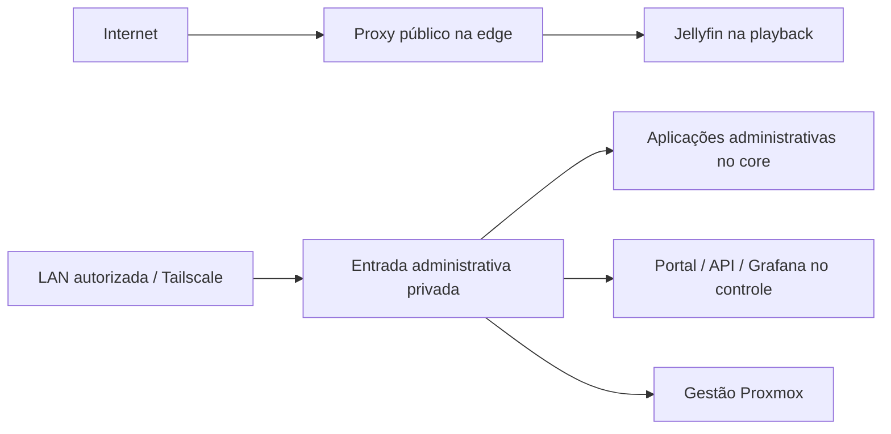

# Domínios e acesso ao homelab

Desenho solicitado em **16/11/2026**, ainda não implantado. O proprietário possui
`greis.dev.br` e definiu Jellyfin público autenticado e administração pela LAN ou
Tailscale. Este documento registra os nomes e as fronteiras; não aplica DNS,
certificados, proxy, ACLs ou regras de roteador. A prioridade continua sendo
[concluir o core e consolidar a mídia no HD de 18 TB](operational-priorities-2026-11-16.md).

## Nomes solicitados

Todos os destinos abaixo são o desenho desejado para os novos nomes. Um serviço
já responder por seu endereço atual não comprova que o domínio esteja operante.

| Nome | Aplicação | Acesso desejado | Caminho proposto |
|---|---|---|---|
| `streaming.greis.dev.br` | Jellyfin | Público, com autenticação da aplicação | Proxy público na edge → Jellyfin na playback |
| `radarr.greis.dev.br` | Radarr | LAN/Tailscale | Entrada administrativa privada → aplicação no core |
| `sonarr.greis.dev.br` | Sonarr | LAN/Tailscale | Entrada administrativa privada → aplicação no core |
| `bazarr.greis.dev.br` | Bazarr | LAN/Tailscale | Entrada administrativa privada → aplicação no core |
| `proxmox.greis.dev.br` | Console/API Proxmox | LAN/Tailscale | Entrada de gestão privada → Proxmox |
| `grafana.greis.dev.br` | Grafana | LAN/Tailscale | Entrada de gestão privada → Grafana no homelab-control |
| `homelab.greis.dev.br` | Portal e API da plataforma | LAN/Tailscale | Entrada de gestão privada → portal/API no homelab-control, na mesma origem |

Os nomes opcionais abaixo são propostas adicionais, sem confirmação de adoção:

| Nome opcional | Aplicação | Limite proposto |
|---|---|---|
| `qbittorrent.greis.dev.br` | Administração qBittorrent | Privado, pelo proxy administrativo; não publicar a porta administrativa nativa na WAN |
| `seerr.greis.dev.br` | Seerr | Privado na LAN/Tailscale; acesso público exigiria uma decisão própria |

## Separação das entradas

O diagrama é uma proposta, sem regras de rede aplicadas por este trabalho. O
proxy público recebe somente a rota de Jellyfin. Não recebe rotas administrativas,
credenciais Proxmox, bancos de controle ou mounts de mídia. As entradas privadas
devem continuar acessíveis aos administradores sem depender do proxy público.
A localização dos proxies privados e suas permissões serão detalhadas conforme
as [fronteiras da plataforma](operations.md) e dos consumidores.

DNS informa o destino, TLS autentica o servidor e protege o transporte, e a
autenticação da aplicação identifica quem pode usá-la. Um domínio próprio e um
certificado válido não autorizam usuários nem fecham portas. As sessões, TOTP,
CSRF e ACLs existentes precisam continuar funcionando com a nova origem; a LAN
também precisa de restrições de gestão. O acesso Tailscale exige política efetiva
e testes de permissão/negação, ainda sem evidência para estes nomes.

## DNS e certificados

A consulta pública somente leitura realizada pela coordenação em 16/11/2026
retornou `a.auto.dns.br` e `b.auto.dns.br` como servidores autoritativos de
`greis.dev.br`, correspondentes ao DNS do Registro.br. Isso não comprova acesso
à conta, disponibilidade de API, integração de renovação ou registros dos sete
serviços. Não se presume Cloudflare nem outro provedor de automação.

A proposta é resolver os nomes administrativos para destinos privados na LAN
e na tailnet, usando DNS interno e, quando necessário, um resolvedor restrito
para `greis.dev.br` no Tailscale. Esse resolvedor deve preservar a resolução de
`streaming.greis.dev.br` e dos demais registros existentes. MagicDNS não permite
adicionar registros arbitrários; um resolvedor privado também precisa estar
alcançável pelos clientes autorizados. A escolha entre endereço Tailscale do
resolvedor e uma rota restrita continua pendente. Ver
[DNS no Tailscale](https://tailscale.com/docs/reference/dns-in-tailscale).

O HTTPS nativo do Tailscale emite certificados para nomes de dispositivos sob
o domínio da tailnet em `ts.net`; isso não emite automaticamente certificados
para `greis.dev.br`. Os nomes solicitados precisam de sua própria emissão e
renovação. Certificados públicos podem revelar nomes em Certificate Transparency,
mesmo quando os serviços são privados. Ver
[certificados HTTPS do Tailscale](https://tailscale.com/docs/how-to/set-up-https-certificates).

Para os serviços privados, a proposta é ACME DNS-01: provar controle do domínio
por TXT em `_acme-challenge`, sem expor portas administrativas à internet. A
renovação deve usar credenciais limitadas à validação necessária, mantidas fora
do Git; evitar entregar credencial ampla da zona ao proxy público. A validação
pode ocorrer separadamente, com entrega controlada dos certificados. Delegação
por CNAME ou NS permite responder ao desafio em outra zona. Ver
[desafios do Let's Encrypt](https://letsencrypt.org/docs/challenge-types/#dns-01-challenge).

A estratégia de automação ainda precisa ser escolhida conforme os recursos
reais da conta DNS:

- Manter o DNS autoritativo atual e delegar os nomes de desafio necessários
  para uma zona com API adequada, limitando as credenciais à validação.
- Migrar o DNS autoritativo para um provedor com automação compatível, após
  inventariar e preservar os registros existentes e definir retorno.

Nenhuma dessas alternativas foi aplicada. Não se pressupõe que a API do
Registro.br permita a automação requerida; isso precisa ser conferido. Essa
escolha não bloqueia o trabalho de mídia e core.

Caddy é uma opção de proxy com emissão/renovação automáticas e suporte a DNS-01
mediante configuração e integração compatível com o provedor. A delegação do
desafio também pode ser usada quando o DNS original não oferece integração.
Isso não determina uma troca do nginx privado existente; o cliente ACME, seus
módulos e a entrega/renovação serão escolhidos na implementação. Ver
[HTTPS automático do Caddy](https://caddyserver.com/docs/automatic-https#dns-challenge).

## Evidências pendentes antes de publicar

| Área | O que falta comprovar |
|---|---|
| WAN e provedor de internet | Endereço recebido pelo roteador, IPv4/IPv6 utilizáveis, CGNAT ou duplo NAT, filtros do provedor e caminho de entrada. Um IP observado num site não prova rota de entrada. |
| Caminho público | Escolha e teste do transporte até a edge, com autenticação Jellyfin e capacidade para streaming; eventual provedor de túnel exige avaliação de suporte, limites e termos. |
| DNS e TLS | Acesso autorizado à zona, estratégia de DNS-01, emissão, renovação e retorno testados; nenhum segredo em código ou documentação. |
| Acesso privado | Resolução na LAN e Tailscale, rota mínima ao resolvedor e aos serviços, políticas ACL/grants efetivas e negação a clientes sem permissão. |
| Isolamento | Nenhuma rota pública aos seis nomes administrativos, aos opcionais privados ou às portas nativas; verificar também IPv6. |
| Aplicações | Origem, sessões e redirecionamentos corretos; clientes Jellyfin reproduzindo por acesso externo; preservação de NFS RO, lease e contenção de storage. |

O [estado de implementação](../implementation-status.md) continua sendo a
referência para o que foi executado. Este desenho não comprova publicação,
configuração do Tailscale ou recuperação automática do storage.
