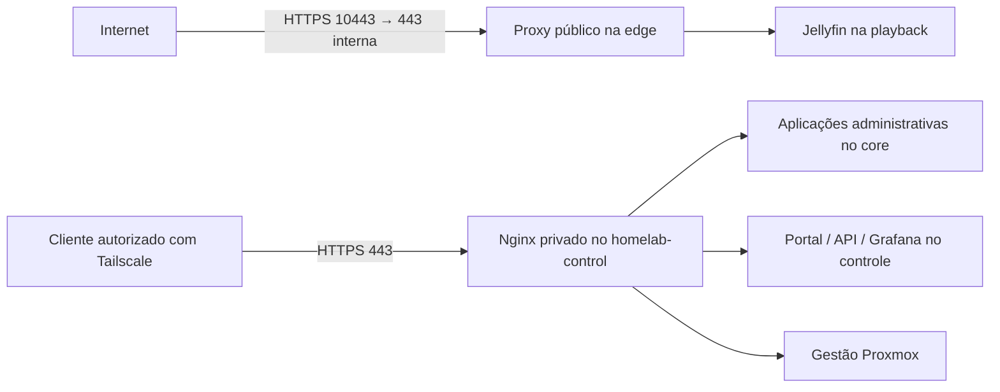

# Domínios e acesso ao homelab

**Nova informação do proprietário — 16/11/2026:** a operadora informou que
não libera as portas nem IP fixo para cliente pessoa física. Depois de avaliar
alternativas, o proprietário aceitou Jellyfin público em `:10443` e serviços
privados com seus domínios por Tailscale. Isso substitui a espera por liberação
de 80/443 como próximo passo; nenhum novo túnel ou DNS foi aplicado.

O Tunnel público padrão da Cloudflare não é a recomendação para transportar
o vídeo do Jellyfin. A [documentação de roteamento](https://developers.cloudflare.com/tunnel/concepts/routing/)
explicita que hostnames públicos nos planos Free, Pro e Business exigem um
serviço pago específico para vídeo e arquivos grandes. A
[política de vídeo](https://developers.cloudflare.com/fundamentals/reference/policies-compliances/delivering-videos-with-cloudflare/)
distingue esse caso das rotas privadas. Desativar cache não transforma uma
rota pública em privada.

**VPS recusada; URL com porta aceita pelo proprietário.** O endereço escolhido é
`https://streaming.greis.dev.br:10443/jellyfin/`, com certificado ACME DNS-01 e atualização
automática do DNS quando o IPv4 residencial mudar. Essa porta recebeu conexões
externas no diagnóstico anterior; isso não comprova HTTPS/reprodução atuais.
A escolha substitui a preferência anterior por URL sem porta. Preservar o
guard público da edge e a administração privada. Ainda faltam certificado,
renovação, DDNS e aceites de reprodução pelo endereço final.

O [DNS-01](https://letsencrypt.org/docs/challenge-types/#dns-01-challenge)
valida o domínio por TXT, sem depender da abertura de 80/443. Cloudflare é
opcional: oferece uma API para automatizar DNS e certificados, mas não é
requisito do Jellyfin, do domínio próprio ou do Tailscale. Se escolhida,
seria usada para DNS/automação, mantendo o registro de streaming como
[DNS only](https://developers.cloudflare.com/dns/proxy-status/), sem passar os
vídeos pelo proxy. O proprietário informou que ainda não adicionou o domínio
à Cloudflare. Provedor e automação DNS não foram escolhidos; nenhuma migração
de nameservers foi aplicada ou escolhida.

Os nomes administrativos terão HTTPS sem porta explícita, via Tailscale.
A proposta inicial publica registros A com o IP Tailscale de `homelab-control`
e reutiliza seu Nginx para a entrada privada em 443, sem resolvedor adicional.
Os nomes ficam consultáveis no DNS público, mas o acesso exige Tailscale e
permissão efetiva; isso não publica os serviços na WAN. Jellyfin permanece
público em 10443 e mantém seu registro A para o IPv4 residencial. Esse desenho
não elimina o limite do upload residencial.

### Diagnóstico anterior à resposta da operadora

**Atualização em 16/11/2026:** backend edge → playback e isolamento de rede
comprovados; 33 checks do proxy passaram, incluindo login comum e negações admin.
DNAT TCP 80/443 aplicado sem reload e HTTP 308 para HTTPS correto pela LAN.
DNS A, WAN e vínculo dos mapeamentos foram conferidos; NAT loopback HTTP funciona
no desktop. **Ainda não há certificado TLS**; ACME e 4G nas portas externas
80/443 deram timeout. A regra temporária WAN 10443 → LAN 443 foi criada: o teste
4G deu erro de protocolo SSL e a captura validada registrou oito SYN externos
distintos chegando a PVE:443. A porta alternativa chega ao mesmo destino interno;
isso ainda não distingue roteador de operadora na falha de 80/443.
Naquele momento, o proprietário escolheu resolver **80/443 e a URL sem porta**
primeiro, mantendo 10443 somente para diagnóstico. Essa decisão foi substituída
pelo aceite de 10443 descrito acima; a ausência de TLS/reprodução aceitos permanece.
Consulta RO: firewall Off, proteção contra ataques Enable, controle parental
desmarcado e tabela IP Filter vazia; Access Control não aparece na UI. O próximo
passo então previsto era suporte Brava conferir filtro/reserva de 80/443 no
equipamento ou a montante.
Auditoria de 15/10 já registrava timeout externo 80/443 e resposta em 54443.
O proxy antigo era TV box Armbian na mesma LAN, com WAN 54443 → LAN 443 e DNS-01;
em 18/10 houve HTTP 200 externo/TLS válido nessa porta alta. A falha padrão
precede a migração, mas ainda não comprova responsabilidade da operadora.
`streaming.greis.dev.br` permanece em ativação, sem anúncio de disponibilidade.
Não se declara implantação dos nomes administrativos privados.

Desenho solicitado em **16/11/2026**, em implantação parcial. O proprietário possui
`greis.dev.br` e definiu Jellyfin público autenticado e administração privada.
Na proposta inicial dos novos nomes privados, o cliente usa Tailscale inclusive
na LAN. Este documento registra os nomes e as fronteiras; não aplica DNS,
certificados, proxy, ACLs ou regras de roteador. A prioridade continua sendo
[concluir o core e consolidar a mídia no HD de 18 TB](operational-priorities-2026-11-16.md).

## Nomes solicitados

Todos os destinos abaixo são o desenho desejado para os novos nomes. Um serviço
já responder por seu endereço atual não comprova que o domínio esteja operante.

| Nome | Aplicação | Acesso desejado | Caminho proposto |
|---|---|---|---|
| `streaming.greis.dev.br` | Jellyfin | Público em HTTPS na porta 10443, com autenticação da aplicação | Proxy público na edge → Jellyfin na playback |
| `radarr.greis.dev.br` | Radarr | Tailscale, HTTPS na porta 443 | Nginx privado no controle → aplicação no core |
| `sonarr.greis.dev.br` | Sonarr | Tailscale, HTTPS na porta 443 | Nginx privado no controle → aplicação no core |
| `bazarr.greis.dev.br` | Bazarr | Tailscale, HTTPS na porta 443 | Nginx privado no controle → aplicação no core |
| `proxmox.greis.dev.br` | Console/API Proxmox | Tailscale, HTTPS na porta 443 | Nginx privado no controle → HTTPS do Proxmox |
| `grafana.greis.dev.br` | Grafana | Tailscale, HTTPS na porta 443 | Nginx privado no controle → Grafana em loopback |
| `homelab.greis.dev.br` | Portal e API da plataforma | Tailscale, HTTPS na porta 443 | Nginx privado no controle → portal/API em loopback, na mesma origem |

Os nomes opcionais abaixo são propostas adicionais, sem confirmação de adoção:

| Nome opcional | Aplicação | Limite proposto |
|---|---|---|
| `qbittorrent.greis.dev.br` | Administração qBittorrent | Privado por Tailscale, pelo proxy administrativo; não publicar a porta administrativa nativa na WAN |
| `seerr.greis.dev.br` | Seerr | Privado por Tailscale; acesso público exigiria uma decisão própria |

## Separação das entradas

O diagrama distingue o destino desejado do backend já aceito; não comprova
publicação externa nem implantação dos nomes privados. O
proxy público recebe somente a rota de Jellyfin. Não recebe rotas administrativas,
credenciais Proxmox, bancos de controle ou mounts de mídia. As entradas privadas
devem continuar acessíveis aos administradores sem depender do proxy público.
A proposta reutiliza o Nginx de `homelab-control`, com listener no IP/interface
Tailscale e destinos de backend limitados por serviço. Não exige nova VM,
resolvedor DNS, exit node ou anúncio de toda a rede dos convidados. As regras
e os aceites devem respeitar as [fronteiras da plataforma](operations.md) e
dos consumidores. O acesso atual de gestão deve continuar disponível durante
a migração dos nomes.

A administração do próprio Jellyfin também permanece privada. A rota
`streaming` deve cumprir o contrato público do consumidor e negar operações
administrativas, inclusive para uma sessão com privilégios elevados. Não basta
ocultar links da interface ou dar outro nome DNS ao mesmo backend. O aceite
deve conferir a reprodução pública e essas negações separadamente; exclusões
continuam sujeitas à autoridade independente do core descrita no
[to-be](to-be.md).

DNS informa o destino, TLS autentica o servidor e protege o transporte, e a
autenticação da aplicação identifica quem pode usá-la. Um domínio próprio e um
certificado válido não autorizam usuários nem fecham portas. As sessões, TOTP,
CSRF e ACLs existentes precisam continuar funcionando com a nova origem; a LAN
também precisa de restrições de gestão. O acesso Tailscale exige política efetiva
e testes de permissão/negação, ainda sem evidência para estes nomes.

## DNS e certificados

A consulta pública somente leitura realizada pela coordenação em 16/11/2026
retornou `a.auto.dns.br` e `b.auto.dns.br` como servidores autoritativos de
`greis.dev.br`, correspondentes ao DNS do Registro.br. Isso não comprova acesso
à conta, disponibilidade de API, integração de renovação ou registros dos sete
serviços. Não se presume Cloudflare nem outro provedor de automação.

A proposta inicial é publicar registros A dos nomes administrativos para o
IP Tailscale de `homelab-control`. O Tailscale documenta esse uso de
[registros DNS públicos](https://tailscale.com/docs/reference/dns-in-tailscale#public-dns-records):
consultar o nome é público, mas conectar ao destino continua exigindo acesso
à tailnet. A política deve permitir somente os administradores autorizados
na porta 443; a autenticação das aplicações permanece. Com vários nomes no
mesmo IP e porta, grants de rede controlam esse destino compartilhado, não
distinguem cada hostname HTTPS. Permissões diferentes por aplicação exigiriam
autorização adicional no proxy ou destinos separados.

O registro de `streaming.greis.dev.br` continua apontando para o IPv4 residencial;
não criar wildcard ou zona interna que substitua essa resposta. Esse desenho
dispensa resolvedor adicional e exige Tailscale ativo no cliente, inclusive
na LAN. Acesso aos mesmos nomes pela LAN sem Tailscale seria uma evolução com
DNS local e regras próprias, não uma capacidade já implantada.

Alguns resolvedores bloqueiam respostas com IP Tailscale por proteção contra
DNS rebinding. Caso observado nos clientes, conferir uma exceção específica
para o domínio ou a configuração de DNS confiável na tailnet, sem desativar
proteções indiscriminadamente. Ver a
[orientação do Tailscale](https://tailscale.com/docs/reference/faq/dns-rebinding).

O HTTPS nativo do Tailscale emite certificados para nomes de dispositivos sob
o domínio da tailnet em `ts.net`; isso não emite automaticamente certificados
para `greis.dev.br`. Os nomes solicitados precisam de sua própria emissão e
renovação. Certificados públicos podem revelar nomes em Certificate Transparency,
mesmo quando os serviços são privados. Ver
[certificados HTTPS do Tailscale](https://tailscale.com/docs/how-to/set-up-https-certificates).

Para os serviços privados, a proposta é ACME DNS-01: provar controle do domínio
por TXT em `_acme-challenge`, sem expor portas administrativas à internet. A
renovação deve usar credenciais limitadas à validação necessária, mantidas fora
do Git; evitar entregar credencial ampla da zona ao proxy público. A validação
pode ocorrer separadamente, com entrega controlada dos certificados. Delegação
por CNAME ou NS permite responder ao desafio em outra zona. Ver
[desafios do Let's Encrypt](https://letsencrypt.org/docs/challenge-types/#dns-01-challenge).

A estratégia de automação ainda precisa ser escolhida conforme os recursos
reais da conta DNS:

- Manter o DNS autoritativo atual e delegar os nomes de desafio necessários
  para uma zona com API adequada, limitando as credenciais à validação.
- Migrar o DNS autoritativo para um provedor com automação compatível, após
  inventariar e preservar os registros existentes e definir retorno.

Nenhuma dessas alternativas foi escolhida ou aplicada. Cloudflare é uma opção
de provedor com API, não uma dependência do desenho. Também é possível validar
inicialmente por TXT manual, mas esse caminho exige nova intervenção em cada
renovação e não atende sozinho ao objetivo de renovação desassistida. Não se
pressupõe que a API do Registro.br permita a automação requerida; isso precisa
ser conferido. DDNS para o registro A público é uma necessidade separada da
validação DNS-01. Essa escolha não bloqueia o trabalho de mídia e core.

Caddy já integra o proxy público da edge; emissão/renovação reais ainda aguardam
aceite. O suporte a DNS-01 depende de configuração e integração compatível com
o provedor. A delegação do
desafio também pode ser usada quando o DNS original não oferece integração.
Isso não determina uma troca do nginx privado existente; a automação DNS-01
para os nomes privados continua por definir. Ver
[HTTPS automático do Caddy](https://caddyserver.com/docs/automatic-https#dns-challenge).

## Preparação da entrada privada

O [Nginx atual do controle](../../infrastructure/control/nginx.conf) termina
TLS na porta 8443 para nomes locais, com acesso pelo host de gestão. API e
Grafana escutam somente em loopback. A proposta dos domínios exige:

1. Integrar `homelab-control` e os clientes administrativos à tailnet e aplicar
   grants para HTTPS privado. Conferir os filtros do convidado e do Proxmox;
   preservar as negações de edge/playback para a gestão.
2. Acrescentar os vhosts privados na porta 443, restritos ao IP/interface
   Tailscale, com certificados DNS-01. Manter a validação da CA no upstream
   HTTPS do Proxmox e suportar WebSocket para seu console.
3. Ajustar `PLATFORM_ORIGIN` para `https://homelab.greis.dev.br`, os links
   `PVE_WEB_URL`/`GRAFANA_URL` e a URL raiz da Grafana. A mudança de `/grafana/`
   para hostname próprio exige configuração coerente de subpath, cookies,
   redirects e sessão; não basta adicionar um registro DNS.
4. Permitir do controle somente os destinos e portas dos backends necessários
   no core, preservando autenticação e caminhos das aplicações. Administração
   qBit, se adotada, passa pelo proxy administrativo, nunca pela porta nativa
   publicada na WAN. Administração Jellyfin continua fora da rota pública.
5. Validar cada nome, login/logout, CSRF, console Proxmox e permissões em
   clientes autorizados e não autorizados. Conferir que a ausência de Tailscale
   impede acesso privado e que a resolução pública de streaming permanece.

Essa preparação não declara Tailscale, certificados ou novos vhosts implantados.

## Evidências pendentes antes de publicar

| Área | O que falta comprovar |
|---|---|
| WAN e provedor de internet | Chegada externa via 10443 comprovada no diagnóstico anterior. Revalidar IP/DNS e o encaminhamento existente na ativação; a liberação de 80/443 deixou de ser condição para esse caminho. |
| Caminho público | Porta 10443 aceita como endereço final, ainda sem aceite TLS/reprodução. Ajustar redirects e origem externa preservando a porta; testar reprodução, Range e WebSocket. |
| DNS e TLS | Escolher provedor e método de automação; testar emissão, renovação e entrega dos certificados DNS-01, além do DDNS público, sem expor portas administrativas ou segredos. |
| Acesso privado | Validar registros para o IP Tailscale do controle, vhosts privados, origens e backends mínimos, grants efetivos e negação a clientes sem permissão. |
| Isolamento | Nenhuma rota pública aos seis nomes administrativos, aos opcionais privados ou às portas nativas; verificar também IPv6. |
| Aplicações | Origem, sessões e redirecionamentos corretos; clientes Jellyfin reproduzindo por acesso externo; administração Jellyfin negada pela entrada pública; preservação de NFS RO, lease e contenção de storage. |

O [estado de implementação](../implementation-status.md) continua sendo a
referência para o que foi executado. Este desenho não comprova publicação,
configuração do Tailscale ou recuperação automática do storage.
