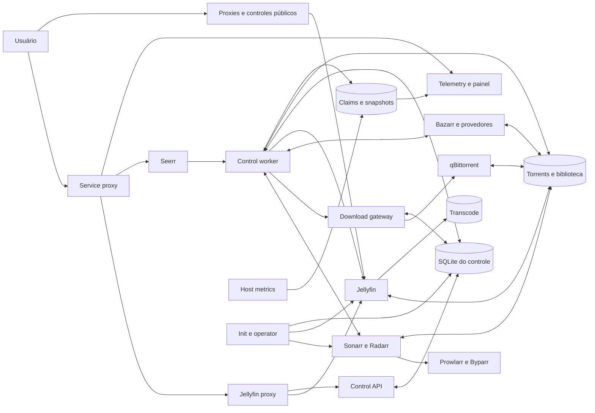

# HomeServer: arquitetura existente em novembro de 2026

Este documento distingue o desenho da aplicação, o estado anteriormente observado e
os arquivos preparados nesta separação. As referências da aplicação estão fixadas
no commit `8627cd8ff76411831c95eb0072f88998c27469e0`; isso não afirma que o commit
esteja implantado. A análise de origem usou um working tree sobre `d5dbcd6`, com
312 alterações preexistentes, e um grafo histórico de setembro apenas para localização.
Os guias atuais e o código prevalecem sobre esse grafo e sobre planos antigos.

A posse documental mudou: esta plataforma contém arquitetura geral, contratos e
observabilidade compartilhada; mídia continua no consumidor. Essa mudança não
cria VMs, exports, isolamento ou readiness no servidor. Confira as
[fronteiras dos repositórios](../repositories.md).

## Registros de preparação e evidências operacionais

O [registro anterior de preparação](https://github.com/reisguilherme/homelab-mediaserver/blob/8627cd8ff76411831c95eb0072f88998c27469e0/docs/architecture/homelab-2026/implementation-status.md)
relata inspeção por SSH de Ubuntu 24.04.5, virtualização disponível, quatro volumes
na união de mídia, manutenção/admissão bloqueada e overrides privados ativos. Havia
verificação anterior de conteúdo ainda incompleta e uma pendência de reparo.
Esses fatos datados não são inventário atualizado nem prova de integridade global.
A proposta de um único USB não descreve automaticamente a implantação encontrada.

O registro também documenta checkpoint privado de código/configuração, verificado
em dois destinos. Aquele checkpoint **não incluía bancos nem constituía cópia
consistente de todas as aplicações**. A separação de repositórios não realizou
SSH, mutação de runtime ou inspeção de dados.

Posteriormente, o proprietário autorizou indisponibilidade. O
[checkpoint operacional de 15/11, commit c2973a4](https://github.com/reisguilherme/homelab-mediaserver/blob/c2973a4bbbe51209e1e0895ab2be79fc552b6723/docs/runbooks/operational-checkpoint-execution.md)
capturou o conjunto de mídia sob quiescência, conferiu a cópia Windows e os
arquivos restaurados em ext4, com 11 bancos SQLite íntegros e 42 imagens
importadas em daemon isolado. Os mesmos 21 serviços retornaram; os nove já
parados, o outro projeto, as montagens e a manutenção foram preservados.
Cron e recuperação USB voltaram, com USB habilitado em `ready`. Naquela etapa
nenhuma aplicação foi iniciada a partir da restauração.

No [ensaio posterior em clones isolados](https://github.com/reisguilherme/homelab-mediaserver/blob/refactor/docs/runbooks/proxmox-preinstallation.md),
13 serviços foram examinados: onze responderam HTTP `200`, e dois componentes
de segurança negaram o cliente não confiável com `403`. As contagens de
catálogo monitoradas não mudaram; os SQLite examinados passaram após a parada
e os daemons de teste foram encerrados. Esse ensaio curto de inicialização
não aceitou reprodução, GPU ou integração completa; `production_ready` e
`partial_restart_safe` permanecem falsos.

Às 18:08 de São Paulo, em 15/11, a captura final ampliada foi selada com origem
estável, incluindo o outro projeto, configurações do host e os sete volumes
Docker. O conjunto cobre 36 containers: os 22 ativos foram parados de forma
limpa e continuam parados; os 14 já inativos foram mantidos. O host segue
ligado e acessível por SSH. A cópia completa no Windows está em transferência,
ainda sem aceite, e a restauração final permanece pendente. Nenhum conteúdo
privado é copiado para a plataforma. O
[roteiro de instalação](../runbooks/proxmox-installation-handoff.md) ainda exige
autorização de sobrescrita do SSD candidato, já identificado no inventário
privado, após fechar a preservação necessária.

## Contexto declarado e alcance da evidência

O usuário declarou um compute com i7-10750H, 16 GB de RAM, dois SSDs de 512 GB e um HD USB de 18 TB.
Declarou conexão de 300 Mbps e objetivo de até dez reproduções simultâneas.
Esses números não são medições: upload, codecs, bitrates, transcodes e throughput USB continuam desconhecidos.
IP público, CGNAT e disponibilidade externa também não foram verificados.
O código contém caminhos de acesso público; sua existência não comprova publicação funcional ou segura no host.
O objetivo futuro de dois ou três computes com Proxmox e Kubernetes não descreve a implantação atual.
As restrições operacionais permanecem as do [guia do agente](https://github.com/reisguilherme/homelab-mediaserver/blob/8627cd8ff76411831c95eb0072f88998c27469e0/AGENTS.md).

## Componentes e interfaces declaradas

As portas abaixo vêm do Compose; uma publicação declarada não comprova acesso por LAN, Tailscale ou internet.
“Interno” indica que a interface não tem publicação própria no host no Compose examinado.

| Componente | Papel e estado persistente | Interface declarada |
|---|---|---|
| `service-proxy` | Entrada por caminhos para painéis | TCP 80 |
| Jellyfin + `jellyfin-proxy` | Reprodução; config/banco próprios; proxy de exclusão coordenada | TCP 8096 pelo proxy; `/jellyfin/` |
| Seerr + `seerr-proxy` | Catálogo/pedidos; appdata próprio | TCP 5055 pelo proxy; atalhos `/seer` e `/seerr` |
| Sonarr / Radarr | Séries/filmes; bancos e configurações próprios | TCP 8989 / 7878 |
| Prowlarr / Bazarr | Indexação / legendas; appdata próprio | TCP 9696 / 6767 |
| qBittorrent | Transferência/seeding; config e payloads persistentes | WebUI 8080 interna; peers 6881 TCP/UDP declarados |
| `qbit-monitor` | Proxy administrativo com autenticação nativa | TCP 18080 em loopback |
| `control-api` | API autenticada, captura de exclusões, estado compartilhado | TCP 8080 |
| `control-worker` | Aquisição, validação, importação, exclusão e reconciliação | Sem porta publicada |
| `download-gateway` | Admissão de downloads e permits persistentes | TCP 8081 interna |
| `telemetry` / `host-metrics` | Painel e snapshots do host/storage | TCP 8081 no host / coletor sem API publicada |
| `init` / `operator` | Preparação e aplicação pontual de preferências | Comandos Compose, sem porta publicada |
| Byparr | Auxílio às consultas de fontes | Interface interna |
| `public-proxy`, `public-security`, `jellyfin-relay`, `integration-proxy` | Caminhos e controles adicionais de acesso/integração | TCP 8097 e 5056 publicados pelo proxy; demais internos |

Fontes: [Compose](https://github.com/reisguilherme/homelab-mediaserver/blob/8627cd8ff76411831c95eb0072f88998c27469e0/compose.yaml), [acesso no README](https://github.com/reisguilherme/homelab-mediaserver/blob/8627cd8ff76411831c95eb0072f88998c27469e0/README.md#L46),
[arquitetura corrente](https://github.com/reisguilherme/homelab-mediaserver/blob/8627cd8ff76411831c95eb0072f88998c27469e0/docs/architecture.md#L55) e [proxy público](https://github.com/reisguilherme/homelab-mediaserver/blob/8627cd8ff76411831c95eb0072f88998c27469e0/deploy/public-proxy/nginx.conf).
Os binds, portas, nomes de serviço e redes pertencem a uma stack Compose local.
Algumas redes têm endereços fixos declarados; nenhum endereço real ou identificador privado é reproduzido aqui.

## Fluxo existente

O diagrama agrupa componentes com a mesma função e mostra relações estáticas, sem afirmar que estejam em execução.

São vinte nós lógicos; appdata dos serviços nativos fica omitido para manter o desenho legível.
O fluxo de importação é coordenado pelo worker; Arr mantém Completed Download Handling desabilitado.
Hardlinks permitem que um vídeo importado continue seedando sem segunda cópia física.
Fonte: [arquitetura e importação](https://github.com/reisguilherme/homelab-mediaserver/blob/8627cd8ff76411831c95eb0072f88998c27469e0/docs/architecture.md#L21).

## Três layouts de armazenamento presentes

| Layout | Arquivos Compose | Caminhos e comportamento |
|---|---|---|
| Base | `compose.yaml` | `/srv/data` como `/data`; torrents e biblioteca no mesmo bind; sem cadastro de pools obrigatório |
| Expansão local | Base + `compose.storage.yaml`; opcionais `extra` e `fourth` | SSD e até três HDs ext4; mergerfs em `/srv/media-view`; visão `/data` comum e binds físicos por pool |
| Disco único | Base + `compose.storage.single.yaml` | Somente pool `hdd3`, físico `/srv/external3/homeserver`, apresentado por mergerfs como `/data` |

O singleton é independente dos overrides de expansão; `hdd3` é o identificador mantido pelo código.
Isso não exige três discos e não comprova que o HD declarado de 18 TB já esteja usando esse layout.
Nos três casos, appdata, controle e transcode têm funções separadas da biblioteca.
Appdata usa `/srv/appdata`; o controle fica em `/srv/appdata/control`; transcode usa `/srv/transcode`.
O diretório de controle aparece nos containers como `/var/lib/homeserver` e/ou `/run/homeserver`.
Fontes: [guia de storage](https://github.com/reisguilherme/homelab-mediaserver/blob/8627cd8ff76411831c95eb0072f88998c27469e0/docs/storage.md#L3), [base](https://github.com/reisguilherme/homelab-mediaserver/blob/8627cd8ff76411831c95eb0072f88998c27469e0/compose.yaml#L348),
[expansão](https://github.com/reisguilherme/homelab-mediaserver/blob/8627cd8ff76411831c95eb0072f88998c27469e0/compose.storage.yaml) e [singleton](https://github.com/reisguilherme/homelab-mediaserver/blob/8627cd8ff76411831c95eb0072f88998c27469e0/compose.storage.single.yaml).

## Garantias implementadas e dependências locais

Estas são propriedades do código e requisitos do procedimento, não resultados de um teste físico nesta análise.

| Mecanismo | Garantia pretendida e evidência |
|---|---|
| Identidade do pool | Exige ext4 físico, raiz montada, origem de dispositivo, UUID e correspondência de device/mountinfo entre host e container. [StorageRegistry](https://github.com/reisguilherme/homelab-mediaserver/blob/8627cd8ff76411831c95eb0072f88998c27469e0/services/common/src/homeserver_common/storage.py#L164) |
| União e capacidades | Startup verifica mergerfs/branches/opções; preparação usa fixtures de escrita, mmap, hardlink, rename e ownership. [Startup](https://github.com/reisguilherme/homelab-mediaserver/blob/8627cd8ff76411831c95eb0072f88998c27469e0/services/common/src/homeserver_common/storage_startup.py#L15), [procedimento](https://github.com/reisguilherme/homelab-mediaserver/blob/8627cd8ff76411831c95eb0072f88998c27469e0/docs/storage.md#L169) |
| Admissão por pool | Torrent inteiro precisa caber em um disco; pendências e margem de 10 GiB por padrão são descontadas. Espaços não são somados entre discos. [Política](https://github.com/reisguilherme/homelab-mediaserver/blob/8627cd8ff76411831c95eb0072f88998c27469e0/docs/storage.md#L63) |
| Medição | Modo base usa `statvfs` e `f_bavail`; pools registrados usam medição física e evidências de fila/snapshot. [Capacidade](https://github.com/reisguilherme/homelab-mediaserver/blob/8627cd8ff76411831c95eb0072f88998c27469e0/services/control/src/homeserver_control/worker/capacity_evidence.py#L200), [pool](https://github.com/reisguilherme/homelab-mediaserver/blob/8627cd8ff76411831c95eb0072f88998c27469e0/services/common/src/homeserver_common/storage.py#L202) |
| Placement | Destino autorizado por permit e pool; claim criado com exclusividade e `fsync`; pais protegidos limitam criação indevida pelo downloader. [Claims](https://github.com/reisguilherme/homelab-mediaserver/blob/8627cd8ff76411831c95eb0072f88998c27469e0/services/common/src/homeserver_common/storage.py#L230) |
| Estado compartilhado | SQLite WAL com timeout e transações `BEGIN IMMEDIATE` coordena reservas/permits entre processos locais. [Reservas](https://github.com/reisguilherme/homelab-mediaserver/blob/8627cd8ff76411831c95eb0072f88998c27469e0/services/control/src/homeserver_control/persistence/db.py#L30), [permits](https://github.com/reisguilherme/homelab-mediaserver/blob/8627cd8ff76411831c95eb0072f88998c27469e0/services/control/src/homeserver_control/gateway/permits.py#L74) |
| Publicação de snapshots | Fila e snapshots usam substituição atômica no diretório compartilhado. [Worker](https://github.com/reisguilherme/homelab-mediaserver/blob/8627cd8ff76411831c95eb0072f88998c27469e0/services/control/src/homeserver_control/worker/__main__.py#L88), [guia](https://github.com/reisguilherme/homelab-mediaserver/blob/8627cd8ff76411831c95eb0072f88998c27469e0/docs/storage.md#L214) |
| Importação | Cria hardlink e verifica identidade; paths de origem e biblioteca precisam de semântica compatível. [Importação](https://github.com/reisguilherme/homelab-mediaserver/blob/8627cd8ff76411831c95eb0072f88998c27469e0/services/control/src/homeserver_control/worker/imports.py#L80) |
| Exclusão coordenada | Captura identidade física e verifica device/inode/tamanho/mtime antes de remover; contagem de links evita prometer espaço ainda referenciado. [Captura](https://github.com/reisguilherme/homelab-mediaserver/blob/8627cd8ff76411831c95eb0072f88998c27469e0/services/control/src/homeserver_control/api/deletion_capture.py#L146), [execução](https://github.com/reisguilherme/homelab-mediaserver/blob/8627cd8ff76411831c95eb0072f88998c27469e0/services/control/src/homeserver_control/worker/deletions.py#L23) |
| Administração de mídia | Jellyfin e Bazarr têm escrita; exclusões de filmes/episódios/temporadas seguem proxy e controlador. [Permissões e fluxo](https://github.com/reisguilherme/homelab-mediaserver/blob/8627cd8ff76411831c95eb0072f88998c27469e0/docs/architecture.md#L63), [bind Jellyfin](https://github.com/reisguilherme/homelab-mediaserver/blob/8627cd8ff76411831c95eb0072f88998c27469e0/compose.storage.single.yaml#L345) |

Ações manuais autorizadas no painel qBit são diretas; aquisições automatizadas continuam passando pelo gateway.
Portanto, o gateway não deve ser descrito como interceptador universal de toda ação administrativa do proprietário.
Fonte: [distinção de caminhos](https://github.com/reisguilherme/homelab-mediaserver/blob/8627cd8ff76411831c95eb0072f88998c27469e0/README.md#L70).

## Limites reais para separação e vários nós

1. Os binds e a validação de UUID/mountinfo dependem do host que possui o disco.
   Trocar o filesystem por NFS, CephFS ou um volume CSI genérico não satisfaz o contrato físico atual.
2. O SQLite é aberto por API, worker e gateway no mesmo diretório persistente.
   Sua configuração WAL não constitui banco distribuído; não foi implementada migração para banco servidor.
3. O heartbeat usa uma única linha `id=1`, sem identidade de réplica ou eleição global de líder.
   O `flock` encontrado protege uma derivação auditada específica, não toda a execução do worker.
   Evidências: [heartbeat](https://github.com/reisguilherme/homelab-mediaserver/blob/8627cd8ff76411831c95eb0072f88998c27469e0/services/control/src/homeserver_control/persistence/heartbeat.py#L20), [lock](https://github.com/reisguilherme/homelab-mediaserver/blob/8627cd8ff76411831c95eb0072f88998c27469e0/services/control/src/homeserver_control/worker/audited_imports.py#L306).
4. Hardlinks dependem de um mesmo filesystem; separar payloads e biblioteca pode exigir cópia e outro orçamento.
   Inodes e devices capturados localmente não são identificadores globais para comparar clientes de rede distintos.
5. mergerfs oferece uma visão de arquivos; o projeto não o usa como RAID, réplica, storage de bloco ou serviço de objetos.
   Um HD, sua conexão USB e o host continuam pontos únicos de indisponibilidade.
6. Capacidade contabiliza o filesystem e os compromissos conhecidos dos downloads, sem quota de VM ou reserva de thin pool.
   Uma futura VM de 1 TB compartilhando o pool precisa de orçamento próprio; tamanho lógico não prova espaço reservado.
7. Métricas e snapshots representam um host; não há inventário de cluster ou agregação de capacidade entre computes.
   Evidência: [coletor com rede do host e binds locais](https://github.com/reisguilherme/homelab-mediaserver/blob/8627cd8ff76411831c95eb0072f88998c27469e0/compose.yaml#L935).
8. Playback separado exige decidir o destino das funções que hoje escrevem metadados/legendas.
   Para o to-be, o proprietário escolheu mover essas alterações à automação privada e deixar Jellyfin RO.
   Preservar caminhos lógicos e exclusão pelo controlador; adaptar entrypoints que hoje exigem mergerfs local para um contrato de leitor remoto, com testes próprios.
9. Não foram encontrados manifests de Kubernetes, charts Helm ou configuração Proxmox no escopo analisado.
   O projeto atual também exclui CI/CD, releases próprias, gerenciador de backups e units do host como camadas gerais.
   Fonte: [escopo atual](https://github.com/reisguilherme/homelab-mediaserver/blob/8627cd8ff76411831c95eb0072f88998c27469e0/docs/architecture.md#L69); recuperação USB opt-in tem documentação específica em [storage](https://github.com/reisguilherme/homelab-mediaserver/blob/8627cd8ff76411831c95eb0072f88998c27469e0/docs/storage.md).

## Observabilidade e recuperação USB existentes

Há snapshots de host, status web e heartbeat do controle. O commit de referência já prepara exporter de snapshots e um Compose opt-in com Prometheus/Grafana; preparação de arquivos não comprova instalação. Nesta separação Prometheus/Grafana passam à plataforma e o exporter permanece no consumidor. A outbox de notificações tem código de deduplicação/retry; não foi encontrado seu consumidor ativo no fluxo inspecionado. Logs locais rotacionados não compõem histórico central ou auditoria de VMs. As evidências e os gaps estão em [operação e governança](operations.md#3-evidência-estática-e-preparação-atual).

O mecanismo USB opt-in já aceita somente `hdd3`, guarda estado, verifica identidade/geração, para consumidores locais e os retoma após conferir mounts e autorizações. O instalador agenda cron por minuto; transições/debounce podem levar vários minutos. A análise estática não comprovava instalação/ativação; o checkpoint anterior de mídia confirmou o retorno do mecanismo habilitado em `ready`, sem ensaiar perda/retorno físicos. Esse retorno antecede a captura final e não descreve a parada atual. O usuário relata perda de energia na fonte AC do HD enquanto o notebook continua na bateria, condição que esse código não previne.

A recuperação atual coordena Docker e mounts no mesmo domínio, sem reanexação Proxmox ou clientes NFS. A prova de payload concluído verifica presença e tamanho, não integridade dos bytes. Chamadas síncronas de filesystem podem bloquear o processo de recuperação; testes existentes não demonstram solução para D-state físico. [Auditoria, links ao código e contrato futuro](power-recovery.md#2-o-que-o-projeto-já-implementa).

## O que permanece sem comprovação

A inspeção anterior identificou overrides privados ativos e alguns checks locais; o checkpoint posterior preservou o conjunto declarado, conforme a evidência datada acima. Os dois SSDs já foram identificados no inventário privado. Saúde completa dos discos, capacidade admissível, mounts e permissões efetivos ainda precisam de validação para o corte.
Não há nesta análise medição de reprodução concorrente, aceleração Intel, CPU, RAM, rede, upload ou recuperação USB.
Também não há validação de acesso externo, TLS, Tailscale, portas efetivamente alcançáveis ou situação de CGNAT.
As evidências acima sustentam o desenho existente e seus contratos; a validação do ambiente requer uma etapa separada.
