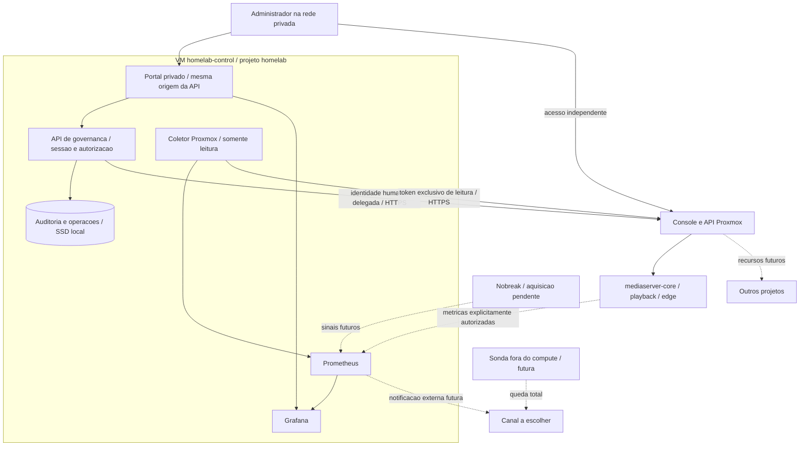

# Observabilidade, administração e governança

Desenho revisto em **15/11/2026** após o proprietário reafirmar que a plataforma
precisa de API, dashboards e controle de VMs próprios, separados do projeto de
mídia. A composição anterior de links para consoles não entregava esse requisito.
Este documento define o destino; o [estado da implementação](../implementation-status.md)
registra o que foi aplicado e testado. O [plano de execução](../plans/2026-11-15-platform-governance.md)
detalha interfaces, tarefas e aceites.

**Estado em 16/11/2026:** homelab-control hospeda API/portal, Prometheus e Grafana
por TLS privado. CRUD/ACL, TOTP, seis targets, falha/resolução de coleta e reboot
do controle passaram em ensaios reais. Portal e 22 painéis passaram no navegador
desktop/mobile; medições sob carga permanecem pendentes. O
[runbook](../runbooks/platform-governance.md) delimita cada prova e limite.

## 1. Plataforma independente dos consumidores

A VM **homelab-control** recebe o portal e a API da plataforma, Prometheus,
Grafana e coleta de infraestrutura. Persistência e auditoria ficam no seu SSD
virtual, sem depender do HD USB, NFS ou containers de mídia. A API implementa
operações delimitadas usando a API HTTPS do Proxmox. O console Proxmox continua
acessível diretamente pela rede de gestão, inclusive com o portal parado.

As setas não concedem conectividade geral. Somente a VM de controle ganha acesso
necessário à API do hipervisor. Media edge/playback não recebem esse acesso nem
credenciais de governança. Grafana não recebe ticket de administrador, token de
mutação, socket Docker ou chave de exclusão de mídia.

### Identidade de recursos

| Recurso | Nome visível Proxmox | Tags | Pool de projeto |
|---|---|---|---|
| Core de mídia | `mediaserver-core` | `mediaserver;core;storage` | `mediaserver` |
| Playback | `mediaserver-playback` | `mediaserver;playback` | `mediaserver` |
| Borda de mídia | `mediaserver-edge` | `mediaserver;edge` | `mediaserver` |
| Governança e observabilidade | `homelab-control` | `homelab;governance;observability` | `homelab` |

Tags e pools identificam posse; ACLs e regras de rede aplicam permissões. Nome
visível não exige mudar VMID, endereço ou hostname do convidado. Perfis de
automação que verificam nomes precisam acompanhar a mudança. O core ainda
abriga o hub físico inicial: dispositivos e exports pertencem à plataforma,
enquanto os dados lógicos e a automação pertencem ao consumidor. Separar esse
hub em `homelab-storage` é evolução futura com orçamento próprio.

## 2. Controle oferecido e limites

| Objeto | Primeira API e portal | Autoridade e complemento |
|---|---|---|
| Inventário | Nó, VMs, projeto, recursos, capacidade, tarefas e idade da coleta | Proxmox é fonte do estado; catálogo acrescenta relações, não cria recursos |
| VMs | Criar por perfil permitido, iniciar, desligar, reiniciar e remover com prévia de impacto | Primeira criação entrega hardware desligado e sem NIC; SO/rede/aplicações exigem preparação no console; tarefa aceita não comprova conclusão |
| CPU/RAM | Consultar e editar com estado/digest esperado, mostrando mudanças pendentes | Hotplug depende do guest; mudança que exige parada não é apresentada como efetiva |
| Acesso por VM | Consultar, conceder e revogar ACL explícita a usuário/grupo existente | ACL herdada aparece com origem; não alterar o ancestral silenciosamente |
| Console e hardware avançado | Link contextual para console Proxmox autenticado | NICs, discos, passthrough e outras opções permanecem no console enquanto não houver endpoint próprio ensaiado |
| Sistema convidado | Contexto e caminho para gestão do SO | ACL Proxmox não cria usuário Linux, chave SSH ou conta de aplicação |
| Aplicações | Links privados e estado de integrações disponíveis | Operações de mídia continuam no repo e API do consumidor |
| Storage e energia | Estado da evidência e motivo de espera quando publicados pelo coordenador | Mount presente não prova saúde; o portal não ignora identidade, integridade ou manutenção |

Excluir VM exige prévia do alvo, nome, digest, impacto resumido e bloqueadores,
seguida de confirmação vinculada à mesma configuração. A prévia atual não
enumera cada volume individualmente. A API recusa
destruição de VM com passthrough físico ou dependência protegida até existir
procedimento específico. USB, exports compartilhados e acervo não viram lixo
da VM. Parada forçada é distinta de desligamento e exige confirmação de impacto.
Nenhum botão executa formatação, comando arbitrário ou limpeza de mídia.

Lock e idempotência coordenam apenas pedidos do portal. Alterações pelo
console ou outra API não participam desse lock. CPU/RAM usam digest upstream;
energia, DELETE e ACL não oferecem comparação atômica equivalente. Prévia e
revalidação reduzem, mas não eliminam, mudança externa entre conferência e
execução. Coordenar essas operações com o uso do console; não prometer exclusão
ou ACL imunes a toda concorrência externa.

## 3. Identidade, sessão e autorização

O portal usa login delegado no Proxmox. O navegador envia credenciais por POST
HTTPS para o backend da mesma origem; login/TOTP só habilitam envio após os
handlers e a leitura inicial da sessão. O proxy não registra query strings.
O backend consulta `/access/ticket` no destino
fixo, com CA e hostname verificados. A senha existe somente durante essa
requisição. Ticket e token CSRF Proxmox ficam em memória no servidor, associados
a uma sessão opaca; não entram no JavaScript, banco, URL, logs ou Grafana.
Reiniciar a API exige novo login, sem apagar o histórico de operações.

O desafio `NeedTFA` nunca estabelece sessão autenticada. A primeira integração
atende TOTP com desafio assinado guardado no backend, prazo curto e tentativa
limitada. Método não implementado é informado como incompatível e continua
disponível no console nativo; não remover MFA para facilitar o portal.
[Contrato de autenticação Proxmox](https://github.com/proxmox/pve-access-control/blob/master/src/PVE/API2/AccessControl.pm).

Cada requisição exige a sessão atual; mutações exigem token CSRF próprio e
origem exata. Cookies usam `HttpOnly`, `Secure` e `SameSite`; não habilitar CORS
aberto. A sessão expira por inatividade e por prazo absoluto. A API usa as ACLs
da identidade delegada em cada operação, incluindo autorização por objeto;
ocultar um botão não concede nem revoga permissão. Inventário e auditoria não
podem revelar VMs inacessíveis ao usuário.

| Papel | Permissões e fonte |
|---|---|
| Proprietário | Administração privada concedida no Proxmox; acesso de recuperação independente preservado |
| Operador | Ações e VMs permitidas pelas ACLs Proxmox, sem elevação pelo portal |
| Observador | Leitura dos objetos autorizados; nenhuma mutação |
| Coletor/capacidade | Token separado e revogável, somente GET para telemetria e prova de capacidade; nunca autoriza mutações humanas |
| Automação | Identidade por função; recuperação de storage não reutiliza login humano ou token de coleta |

Tokens com privilégios separados têm alcance limitado pela interseção das ACLs
do usuário e do token. Os privilégios e parâmetros foram conferidos no schema
da versão instalada. A prova de capacidade exige leitura global completa,
verifica ACLs/ausência de grupos e overrides, privilégios e separação do token
antes e depois do snapshot; falha impede nova alocação. A identidade interna
de coleta não pode ser modificada pelo endpoint ACL do portal. Não criar token global de
administrador para contornar uma negação.
[ACLs e tokens Proxmox](https://github.com/proxmox/pve-docs/blob/master/pveum.adoc).

## 4. Operações e auditoria

A API possui rotas e parâmetros tipados. Não oferece proxy genérico para paths
Proxmox, root SSH, QGA arbitrário, shell do host ou socket Docker. Alterações
registram intenção durável antes da chamada externa, com chave de idempotência
e estado observado. Falha ao persistir auditoria impede a mutação.

Resposta com UPID indica tarefa iniciada. Sucesso exige `stopped` e `exitstatus`
aceitável; timeout ou resposta ambígua deixam a operação em reconciliação, sem
repetir criação/exclusão automaticamente. Se não houver mais credencial válida
para consultar o resultado, mostrar a pendência e pedir novo login.
Criação sem UPID ou prova suficiente fica em reconciliação e impede novas
alocações no mesmo nó até investigação; não liberar outra tentativa por timeout.
[API de tarefas](https://github.com/proxmox/pve-manager/blob/master/PVE/API2/Tasks.pm).

SQLite fica no SSD da VM de controle, com transações. A implementação atual
ainda não tem poda/retenção automática; monitorar ocupação e definir manutenção
antes de crescimento sustentado. Registro mínimo: horário sincronizado, identidade,
ação, alvo, parâmetros permitidos, estado anterior relevante, identificador de
operação/tarefa e resultado. Senhas, tickets, tokens, `.env`, URLs de sessão e
nomes de mídia ficam excluídos. Detalhes de auditoria são autenticados e filtrados
pela autorização; não são labels Prometheus. Histórico local não resiste ao
comprometimento do próprio administrador/SSD; cópia externa independente é uma
lacuna, não uma garantia deste desenho.

## 5. Recursos e observabilidade

O orçamento escolhido é **2 vCPU, 2 GiB de RAM e disco virtual de 24 GiB** para
homelab-control. Esse guest foi criado e a RAM do core reduzida de 6 para 4 GiB
após medição e parada limpa, mantendo 11 GiB totais de guests, 3 GiB de
orçamento do host e cerca de 1,49 GiB de margem. Memória livre momentânea
não garante retomada futura da automação; medir novamente sob essa carga.
[Conta de RAM e thin pool](to-be.md#orçamento-inicial-de-recursos).

Prometheus mantém teto de 512 MiB, Grafana de 384 MiB. API/coletor têm teto
inicial conjunto de 384 MiB; SO, cache e demais processos usam a margem interna
da VM. Os valores são orçamentos para ensaio, não medições. Não incluir Loki,
Alloy, traces ou Immich sem nova conta. TSDB, auditoria e Grafana ficam em SSD
local; Prometheus tem retenção de sete dias/4 GiB, enquanto SQLite ainda não
tem poda automática. Alertas de espaço não criam quotas nos binds.

| Visão | Fonte inicial | Limite explícito |
|---|---|---|
| Nó e VMs | API Proxmox, coleta a cada 30 s | Dados do hipervisor não substituem métricas internas do guest |
| Capacidade | Uso físico de storage, tamanhos virtuais, data/metadata thin quando disponíveis | Volume lógico não é reserva física; ausência de indicador aparece como desconhecida |
| Operações e acesso | API e auditoria local | Não inclui automaticamente alterações externas à plataforma |
| Storage e recuperação | Evidência sanitizada do coordenador, com idade | USB/SMART/energia só aparecem após existir integração real |
| Saúde da observabilidade | Estado dos scrapes, idade, falhas, disco e memória | O próprio painel pode cair junto do host |
| Mídia e outros consumidores | Exporters explícitos privados por projeto | Não inferir coleta ativa por haver contrato no catálogo |

Labels limitam-se a nó, VM, projeto, serviço e estados enumerados. Não incluir
usuários, títulos, paths, IP de clientes ou IDs ilimitados de operação. Dados
ausentes/antigos aparecem como desconhecidos, sem converter falha de coleta em
zero saudável. A rede Docker `homelab-metrics` só conecta containers do mesmo
daemon; entre VMs são necessários destino privado e regra efetiva próprios.
[Guia de observabilidade](../observability.md).

Alertas precisam de regra, duração, severidade, responsável, runbook e resolução.
O primeiro painel mostra alertas locais de coleta, capacidade e falha de
operações. A indisponibilidade real do coletor e de um exporter por 150 s
disparou os dois alertas de coleta; eles resolveram após a restauração. Entrega externa depende de canal escolhido e teste efetivo; não
declarar notificações operacionais antes disso. Uma sonda fora deste compute é
necessária para detectar queda total. Nobreak e teste de energia permanecem
pendentes.

## 6. Aceite

| Evidência | Alcance em 16/11/2026 |
|---|---|
| CRUD/ACL reais | 14 checks, oito operações concluídas em VM descartável; criação idempotente, RAM, start/stop, ACL, negações, exclusão, auditoria e logout; VM removida |
| TOTP real | Cinco checks incluindo desafio sem cookie, código errado negado, correto com Secure e ACL, logout; identidade de ensaio removida |
| Coleta e alertas | Seis targets ativos, 22 painéis provisionados, falha real de duas fontes e resolução; nenhum alerta ativo ao final |
| Navegador real | Portal em leitura, login/visões/ACL/atividades/logout e Grafana com sessão própria; desktop/390 px sem overflow ou exceções; 22 consultas sem erro, ALERTS vazio exibido como “Sem dados” |
| Reboot do controle | Sessão anterior negada, histórico SQLite e banco Grafana preservados, quatro containers sem OOM e seis targets ativos; autostart ordem 5 |
| Verificação local | 236 testes pytest, Ruff check/format e dez testes Node; onze grupos de cenários de navegador com API sintética |
| Ainda pendente | Shutdown/reboot ACPI pelo portal com SO, consumo sob carga, manutenção SQLite, canal externo e sonda independente |

Timeout, falha após envio, permissões revogadas e concorrência têm verificações
sintéticas; nem todos foram induzidos no host real. CPU/RAM têm digest nativo,
mas DELETE/energia/ACL conservam a janela externa descrita acima. Reconciliação
sem UPID/prova pode requerer intervenção manual. O reboot isolado do controle
não demonstra tolerância à queda do único host, à falha USB ou de energia.
Controle avançado continua no caminho nativo com sua própria autorização.
