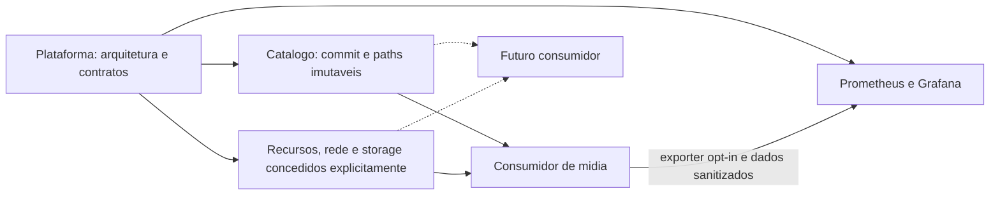

# Plataforma e projetos consumidores

O desenho aprovado separa infraestrutura compartilhada de aplicações. Esta
separação é de responsabilidade e versionamento; não altera a implantação atual.
A [decisão de arquitetura](design/repository-separation.md) registra o escopo.

| Repositório | Fonte canônica |
|---|---|
| [homelab-platform](https://github.com/reisguilherme/homelab-platform) | Arquitetura geral, contratos versionados, catálogo, configuração compartilhada de Proxmox/rede/storage e observabilidade central |
| [homelab-mediaserver](https://github.com/reisguilherme/homelab-mediaserver) | Código e componentes de mídia, Compose/manifests, dados lógicos, exporter, dashboard específico, testes e runbooks da aplicação |
| Futuro consumidor, como Immich | Repositório próprio com aplicação, manifests, contrato e operação próprios; não é implantação já criada |

A plataforma mantém o desenho e as precondições de Proxmox; esta entrega não
contém instalador de hypervisor/VMs. K3s é evolução futura documentada. Um projeto
de mídia continua reunindo seus componentes internos; não criar um repo por
container. A configuração central não faz build nem importa módulos da aplicação.

## Quem decide e executa cada operação

| Área | Plataforma | Consumidor |
|---|---|---|
| Compute | Recursos de hosts/VMs, capacidade física e acesso privado | Necessidade de CPU/RAM, runtime e colocação suportada |
| Rede | Zonas, firewall, caminho de gestão e conectividade concedida | Portas necessárias, exposição pretendida e política nativa da aplicação |
| Storage | Dispositivos, energia, mounts/exports, ACLs e orçamento entre consumidores | Dados lógicos, semântica requerida, DB, capacidade de trabalho e recuperação própria |
| Observabilidade | Prometheus/Grafana, coleta e retenção compartilhadas | Exportação de métricas sanitizadas, sinais de saúde e dashboard específico |
| Falha de storage | Uma autoridade coordena incidente, geração, disponibilidade física e export | Bloqueio, quiescência, reconciliação, readiness e retomada autorizada |
| Exclusão | Concede acesso sem ampliar o escopo do consumidor | Mídia excluída somente pelo controlador e fluxo autorizado; nenhuma limpeza automática |

Storage e automação podem continuar juntos na VM core inicial sem fundir a posse
dos repositórios. O código USB fortemente acoplado à mídia permanece no consumidor;
movê-lo mecanicamente ou executar duas automações de recuperação quebraria a
coordenação. O [fluxo de recuperação](architecture/power-recovery.md) é requisito
para a futura separação física, ainda não uma integração implementada.

## Contrato obrigatório por consumidor

Cada consumidor mantém seu contrato versionável junto dos manifests. O
[guia de integração](integration-contract.md), os [schemas v1](../contracts/v1/service.schema.json)
e o [template](../templates/service.contract.json) definem os campos exatos aceitos.
O contrato precisa declarar:

- Identidade, repositório e runtime (`compose-vm` ou `k3s`), sem assumir que ambos
  já estão provisionados.
- CPU/RAM/armazenamento solicitados e restrições de colocação, com orçamento
  explícito antes de consumir capacidade compartilhada.
- Interfaces e exposição, mantendo gestão privada e privilégios limitados;
  nenhuma herança de administração global do host, Docker ou Proxmox.
- Storage requerido por tipo e acesso RO/RW, incluindo estado persistente e
  dependências de semântica. DB não vai diretamente para compartilhamento RWX/NFS
  inadequado; arquivo de VM em backend NFS é um contrato distinto.
- Métricas, saúde/readiness e sinais de dados ausentes/atrasados, sem confundir
  processo vivo com progresso ou disponibilidade do storage.
- Apenas nomes de segredos; valores ficam no `.env` privado da implantação,
  sem `*_FILE` nem cópias de `.env` no catálogo.
- Responsável por recuperação, comportamento de parada, validações e retomada,
  preservando manutenção e pausas manuais.

Validar JSON verifica estrutura e algumas invariantes estáticas. **Não concede
acesso, reserva espaço/RAM, cria quota, altera ACL/firewall, comprova readiness ou
autoriza implantação.** A plataforma precisa conceder somente as permissões
efetivas e verificar capacidade física livre/comprometida com todos os consumidores.
Thin provisioning, capacidade lógica de PVC ou soma dos nós não garantem espaço.
Requisitos não representados por campos do schema ficam no runbook referenciado,
sem estender o JSON com campos não aceitos.

## Catálogo, referências e evolução

O [catálogo](../catalog/services.json) referencia o consumidor por commit de 40
hexadecimais e paths relativos do contrato e dos manifests; o contrato aponta
para o runbook do consumidor. Não copiar manifests
para a plataforma, usar branch mutável como prova de versão ou registrar paths
absolutos privados. `proposed` documenta intenção; `deployed` exige evidência
operacional correspondente. Publicação de código não muda automaticamente o status.

A integração de observabilidade inicial funciona em um daemon Docker por rede
interna compartilhada e targets privados opt-in. Não publica Prometheus/exporters
nem promete conectividade entre VMs. O caminho entre guests precisa de endereço
privado, firewall, autenticação/TLS conforme o caso e ensaio próprio. A plataforma
começa sem consumidores monitorados até o operador cadastrar os targets; self-scrape
não monitora aplicações. O [guia de observabilidade](observability.md) contém os
procedimentos preparados.

Arquitetura antiga de mídia fica no histórico Git; os links técnicos desta
documentação usam o
[commit de referência](https://github.com/reisguilherme/homelab-mediaserver/tree/8627cd8ff76411831c95eb0072f88998c27469e0).
Runbooks e contratos específicos permanecem no consumidor. Evoluir a plataforma
não autoriza aplicar configuração ou remover guards existentes: revisão local,
regressões relevantes e ensaios autorizados precedem qualquer corte.

Um futuro Immich precisa de contrato separado para uploads e biblioteca externa
RO, PostgreSQL em storage apropriado, recursos medidos e retomada própria. Não
herda a export RO de playback, o diretório de torrents ou todo o acervo. K3s futuro
também não resolve sozinho estado, quorum, USB/GPU ou capacidade de recuperação.
