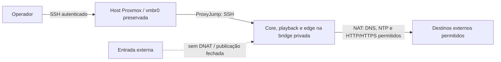

# VMs Ubuntu e rede privada no Proxmox

Este roteiro registra a etapa posterior à [entrega do host](../implementation-status.md#host-proxmox-entregue).
As três VMs de mídia foram entregues com sistema e acesso administrativo
verificados. No bootstrap abaixo, ainda não havia Docker ou aplicações.
Depois, o HD de 18 TB foi entregue ao core, NFS RO foi aplicado e Jellyfin
foi aceito privadamente na playback. A etapa de governança criou uma quarta
VM, `homelab-control`, e reduziu o core de 6 para 4 GiB após medição, mantendo
11 GiB totais de guests. Sua base e nginx TLS estão operantes; API/portal e
Grafana ainda não foram implantados. Consulte
[storage](storage-core-handoff.md) e [governança](platform-governance.md).
Publicação, demais aplicações, GPU e recuperação USB permanecem pendentes.

## Identidade no Proxmox e renomeação

As três VMs deste bootstrap pertencem ao consumidor de mídia. Os nomes
definidos para o inventário do Proxmox são `mediaserver-core`,
`mediaserver-playback` e `mediaserver-edge`, com a tag `mediaserver`.
`homelab` identifica recursos próprios da plataforma, incluindo governança,
painéis e controles compartilhados. A plataforma continua responsável pelo
provisionamento, rede e storage físico. Nome e tag não substituem ACLs.

O gerador produz esses nomes para novas implantações. Os registros abaixo
descrevem as provas do bootstrap original por papel; não demonstram que uma
renomeação posterior já ocorreu. O estado atual e seu aceite ficam no
[registro de implementação](../implementation-status.md).

Para corrigir uma VM existente, usar seu VMID já conferido e uma alteração
de metadados, sem reaplicar o bundle, recriar guests ou trocar discos:

1. Registrar privadamente `qm config <VMID>` e confrontar papel, discos,
   endereços e nome esperado. Preservar tags adicionais que não indiquem
   propriedade; retirar a tag `homelab` somente das VMs de mídia.
2. Colocar o coordenador de storage em `HOLD` pelo procedimento de
   [contenção](../../infrastructure/storage/README.md). Esperar os processos
   QGA pendentes terminarem antes de alterar nomes ou o perfil. Não apagar
   estado para ignorar operação ainda desconhecida.
3. Antes de mudar nome ou reiniciar, obter pelo QGA do host autenticado o
   instance-id atualmente usado em `/var/lib/cloud/instance`, o hostname e
   as fingerprints SSH. Criar um snippet privado de metadata NoCloud com
   **esse mesmo instance-id**, único para a VM. Acrescentar sua referência
   `meta=local:snippets/<arquivo>` a `cicustom`, preservando todas as entradas
   existentes, inclusive `vendor`, `user` e `network`. Não usar um ID novo,
   limpar `/var/lib/cloud` ou executar `cloud-init clean`. Conferir o arquivo
   e sua referência; o dump do metadata gerado pelo PVE pode mostrar o
   conteúdo automático, portanto não é prova suficiente do snippet aplicado.
4. Aplicar `qm set <VMID> --name mediaserver-<papel> --tags <tags-revisadas>
   --description <descricao-revisada>` com argumentos individuais e valores
   conferidos. A descrição deve identificar `owner=mediaserver` e o papel;
   manter qualquer informação operacional já necessária.
5. Atualizar os nomes esperados no perfil privado do supervisor, usando a
   transição de estado compatível com seu digest. Não alterar VMID, USB,
   mount ou configuração de rede para acompanhar a mudança de nome.
6. Conferir novamente configurações, acesso e checks da aplicação. Só
   readmitir storage com `resume` explícito e prova nova, respeitando pausas
   manuais. No próximo reboot autorizado, verificar o instance-id efetivo,
   hostname, cloud-init, chaves SSH e aplicação. Registrar o resultado
   separadamente da evidência anterior.

O nome do Proxmox participa do hostname no user-data automático. NoCloud
gera o instance-id a partir de user-data e rede quando não há metadata
próprio; uma mudança pode ser interpretada como nova instância. A etapa de
renomeação da playback comprovou hostname novo e regeneração de chaves após
reboot. A identidade nova foi verificada via QGA autenticado antes de atualizar
o known_hosts. Se SSH recusar uma chave, não desabilitar a verificação nem
aceitar a chave apenas pelo endereço. A fixação do instance-id evita esse
motivo de reinicialização dos módulos por instância; não dispensa conferir
hostname e DNS nem impede alterações deliberadas de identidade.
[Geração oficial de cloud-init no Proxmox](https://github.com/proxmox/qemu-server/blob/master/src/PVE/QemuServer/Cloudinit.pm),
[identidade NoCloud](https://docs.cloud-init.io/en/latest/reference/datasources/nocloud.html),
[módulo SSH e frequência por instância](https://docs.cloud-init.io/en/latest/reference/modules.html#ssh).

## Estado comprovado no bootstrap

| Papel | vCPU | RAM fixa | Disco virtual | Resultado |
|---|---:|---:|---:|---|
| Core | 4 | 6 GiB | 160 GiB | Ubuntu 24.04, QGA e SSH operantes |
| Playback | 4 | 4 GiB | 80 GiB | Ubuntu 24.04, QGA e SSH operantes |
| Edge | 1 | 1 GiB | 16 GiB | Ubuntu 24.04, QGA e SSH operantes |

Neste bootstrap, os discos somavam 256 GiB dos 348,82 GiB do pool inicial: sobravam 92,82 GiB
planejados, ou 26,61%. Essa reserva considera os tamanhos virtuais completos;
o uso físico de um thin pool muda com as escritas e exige acompanhamento.
A RAM somava 11 GiB para convidados, 3 GiB de orçamento do host e 1,49 GiB de
margem sobre os 15,49 GiB utilizáveis. Não é medição de capacidade sob carga.
O orçamento atual, com transcode e controle, está no
[to-be](../architecture/to-be.md#orçamento-inicial-de-recursos); não reutilizar
a reserva nominal inicial como capacidade disponível hoje.

Todas as VMs estão `running`, com QEMU Guest Agent respondendo, SSH por
`ProxyJump` via host autenticado e NTP sincronizado. As chaves de host dos
guests foram obtidas pelo QGA antes da conexão SSH. O cloud-init terminou com
`errors: []`; o único aviso é a depreciação do campo `user` como string gerado
pelo PVE, a revisar antes do cloud-init 27.2. Após os testes iniciais, `onboot`
foi habilitado em ordem **core → playback → edge**, inversa no desligamento.
Essa ordem inicia as VMs base; não espera readiness de NFS ou aplicações.
Nenhum disco físico foi formatado, montado ou passado aos convidados nesta etapa.

## Rede aplicada e alcance dos testes

No PVE 9.2.2, `vmbr0` e a gestão existente foram preservados. Os convidados usam
uma bridge privada sem porta física, com NAT de saída e **sem DNAT**. O firewall
legado `pve-firewall` está `enabled/running`; as regras de cada VM negam entrada
e saída por padrão e permitem somente os fluxos do bootstrap. O firewall do
host mantém `enable: 0`: a restrição da gestão pela LAN continua sendo um gap.
Os testes de bloqueio abaixo partem dos convidados; não comprovam uma ACL da LAN.



As 21 provas TCP passaram: duas permitidas e 19 negadas.

| Prova TCP real | Resultado | Limite |
|---|---|---|
| Core → playback:8096 | Permitido | Listener temporário; Jellyfin não está instalado |
| Playback → core:2049 | Permitido | Listener temporário; não prova NFS, export ou mídia RO |
| Playback → core:8080/22; core → playback:22 | Negado | Portas e origens examinadas |
| Edge → core:2049/8080 e playback:8096/18096 | Negado | A entrada pública da playback continua fechada |
| Todas → gateway privado:22/8006, endereço LAN do host:8006 e destino Tailscale:8096 | Negado | Não equivale a isolamento absoluto |
| DNS e HTTPS Ubuntu nos três guests | Resolução e HTTP `200` | Conectividade de bootstrap, não readiness das aplicações |

Há filtros IPv4 na tabela `raw`, vinculados à interface física virtual de
origem (`physdev`), que validam IP/MAC **antes de conntrack**; IPv6 é descartado.
Filtros `ebtables` nas chains `INPUT` e `FORWARD` limitam MAC, IP/MAC do
remetente ARP e frames VLAN. Os hooks são idempotentes e permaneceram presentes
após reinício do firewall. Probes de dois quadros por caso confirmaram aumento
dos contadores DROP para IP/MAC forjados, remetente ARP forjado, VLAN 0, VLAN
100, 802.1ad 100 e IPv6. Os contadores foram comparados antes/depois, sem zerar.
No caso 802.1ad, o descarte apareceu no contador `802_1Q` devido à representação
do backend legado/kernel. Esses probes não demonstram cobertura de todo ataque
possível.

O reboot posterior foi comprovado pela mudança do boot ID. As três VMs
subiram automaticamente, com QGA e SSH por ProxyJump preservando suas chaves.
HTTPS do PVE retornou `200` com CA e identidade IP/SAN conferidas; nenhuma
unit ficou em falha. Os hashes das configurações das duas bridges permaneceram
iguais; NAT e guards `raw`/`ebtables` persistiram sem duplicatas. A matriz de
21 testes TCP e DNS/HTTPS Ubuntu passou novamente nos três guests. Os probes
de quadros são da rodada anterior ao reboot; não foram repetidos nessa checagem.

Os endereços WAN atuais de gestão/publicação constam em `blocked_egress` para
evitar retorno pelo NAT do roteador. Como podem mudar, revalidá-los antes de
publicar e quando a WAN mudar. A saída HTTP/HTTPS permitida não é filtragem por
domínio. O backend legado usa filtros por VM e hooks explícitos; não presumir
que regras `FORWARD` do novo backend sejam aplicadas por ele.
[Firewall oficial Proxmox](https://github.com/proxmox/pve-docs/blob/master/pve-firewall.adoc).

## Imagem e configuração dos convidados

Foi usada a imagem oficial **Ubuntu 24.04 LTS amd64, release 20261017**,
`ubuntu-24.04-server-cloudimg-amd64.img`, com 621.284.352 bytes e SHA-256:

```text
04e8f2461a16a44e78a370284471f29616cdd9baf1893df25807b71f985b6c94
```

A assinatura de `SHA256SUMS` foi validada com a chave cloud-image oficial
`D2EB44626FDDC30B513D5BB71A5D6C4C7DB87C81`; a linha amd64 foi selecionada de
forma exata e os bytes locais foram conferidos. Os recibos ficam privados.
[Imagem datada](https://cloud-images.ubuntu.com/releases/noble/release-20261017/),
[checksums](https://cloud-images.ubuntu.com/releases/noble/release-20261017/SHA256SUMS),
[procedimento Canonical](https://ubuntu.com/docs/public-images/public-images-how-to/verify-image-checksum/).

O cloud-init recebe usuário, chave pública e rede pelo PVE. O snippet
`vendor` acrescenta QGA e NTP dentro do guest, sem substituir o `user-data`
gerado e sem instalar pacotes no host. Os discos usam VirtIO SCSI e cada guest
tem console serial. Chaves privadas permanecem no operador; obter a chave de
host pelo QGA/console autenticado e conferir uma sessão separada antes de
aceitar o SSH da VM. [Cloud-init no Proxmox](https://github.com/proxmox/pve-docs/blob/master/qm-cloud-init.adoc).

Novos bundles também incluem `homelab-meta-<VMID>.yaml` com um instance-id
fixo por VM: SHA-256 de um namespace versionado, serial do sistema, nó e VMID.
Ele não depende de nome, papel, rede ou chave SSH. O argumento `cicustom`
referencia esse arquivo e preserva o vendor snippet; user-data e rede
continuam gerados pelo PVE. Instalar cada metadata no storage de snippets
antes do primeiro start. Manter o mesmo arquivo durante a vida da VM e em
migrações; não recalcular identidade de VM existente a partir de outro host.
Clones ou VMs realmente novas precisam de ID próprio. Esses snippets são
privados como o bundle; o teste offline verifica conteúdo e referências, não
a identidade efetiva após boot.

## Gerar o bundle sem aplicar

O [gerador](../../scripts/proxmox_bootstrap.py) funciona offline: valida o
perfil e escreve arquivos para revisão. Não consulta o servidor, executa SSH,
cria VMs ou aplica comandos. O [perfil de exemplo](../../infrastructure/proxmox/profile.example.json)
contém valores fictícios; perfil, inventário e bundle reais ficam fora do Git.

Na raiz do repositório, com Python 3.12 e entradas/saída em pastas privadas:

```bash
python scripts/proxmox_bootstrap.py /caminho/privado/profile.json \
  --public-key /caminho/privado/operator.pub \
  --out /caminho/privado/bundle-novo
```

A pasta de saída deve ser nova e seu diretório pai já deve existir. A chave
deve ser ED25519 pública válida. O bundle contém fragmento de interfaces,
forwarding IPv4, configurações de firewall, chave pública, vendor-data,
metadata com identidade fixa por VM e
`plan.json` com comandos estruturados por argumentos. Os campos `applied`
e `live_preflight_passed` começam falsos. A geração não concede aceite de runtime.

## Preflight independente

Coletar um inventário privado confiável pelo host autenticado imediatamente
antes de uma nova implantação. O verificador consome esse snapshot; **não
descobre nem comprova sozinho a identidade física do storage**.

| Campo exigido | Evidência a coletar |
|---|---|
| `observed_at` | Data/hora ISO 8601 com fuso; idade máxima de 15 minutos |
| `node`, `system_serial`, `storage` | Nó correto, serial do SSD autorizado e storage `local-lvm` |
| `existing_vmids` | IDs presentes no cluster, para impedir colisão |
| `interfaces` | Interfaces reais; a nova bridge precisa estar ausente |
| `storage_total_gib`, `storage_free_gib` | Capacidade total e livre atual do thin pool |
| `memory_gib` | RAM utilizável do host |
| `networks` | Redes e rotas existentes, incluindo gestão, VPN e redes privadas |

Confrontar modelo/serial, `lsblk`, PV/VG/LV e a definição do storage: o caminho
`local-lvm` deve resolver ao SSD autorizado. Não confiar em `/dev/nvme*`, cuja
ordem já mudou neste host. O verificador exige igualdade entre os campos do
perfil e inventário, IDs livres, bridge ausente, subnet sem sobreposição,
RAM das VMs mais pelo menos **4 GiB para host e margem**, e sobra de pelo menos
**20% da capacidade total do pool** após descontar todos os discos planejados.
Um snapshot fabricado ou desatualizado não oferece essas garantias.

```bash
python scripts/proxmox_bootstrap.py /caminho/privado/profile.json \
  --inventory /caminho/privado/inventory.json
```

`--inventory` é uma operação separada de `--out`/`--public-key`. Recolher o
snapshot se expirar ou houver mudança. No host já provisionado, os IDs e a
bridge existem: uma nova tentativa de bootstrap deve recusar, sem apagar
recursos ou ajustar o inventário para fazê-la passar.

## Aplicação controlada

Este procedimento explica a passagem realizada e futuras implantações
autorizadas; não instrui reaplicar o bundle ao host atual.

1. Conferir o preflight, imagem e sintaxe usando o help/API da versão instalada.
   Salvar privadamente as configurações anteriores de rede, sysctl, storage
   e firewall e registrar quais arquivos/regras serão acrescentados. Preservar
   `vmbr0`, sua interface Ethernet USB e a sessão administrativa autenticada.
2. Preparar retorno temporizado por processo pontual, independente da sessão
   SSH, **sem criar unit do host**. O retorno deve conter somente os recursos
   dessa alteração e parar convidados antes de remover seus filtros. Confirmar
   que está armado e que seu comando de cancelamento corresponde ao processo
   correto. Não substituir a configuração inteira por defaults.
3. Instalar os arquivos revisados, preservando conteúdos existentes e habilitando
   `snippets` sem remover outros tipos do storage. Validar o fragmento com o
   parser local. Neste host, `bridge-fd 2` foi aceito; não substituir por zero
   por analogia com exemplos. A bridge privada não tem porta física.
4. Aplicar somente `ifup vmbr1` para a bridge privada nova. **Não executar
   `ifdown vmbr0`, reiniciar networking ou usar recarga global nesta passagem.**
   Conferir NAT, sysctl e guards antes de iniciar guests. A escolha da operação
   localizada é específica deste procedimento; a documentação Proxmox descreve
   também o fluxo geral de aplicação por ifupdown2.
   [Rede oficial](https://github.com/proxmox/pve-docs/blob/master/pve-network.adoc).
5. Aplicar as regras de cluster/VM e os hooks; conferir backend, compilação,
   ordem e contadores reais. `enable: 0` do host preserva a gestão existente e
   não pode ser apresentado como hardening da LAN. Manter segunda sessão SSH
   e HTTPS do PVE operantes antes de cancelar o retorno temporizado.
6. Executar os comandos `qm` revisados para criar VMs e importar discos novos
   somente em `local-lvm`; respeitar os tamanhos absolutos e `onboot=0`. O
   bundle não contém `qm start`. Conferir config, NIC com `firewall=1`,
   filtros e dados cloud-init **antes de dar o primeiro start**.
7. Iniciar e conferir QGA, cloud-init, IP/NTP e chaves do host. Usar ProxyJump
   com verificação estrita de identidade, sem encaminhar a chave privada ao
   PVE. Repetir a matriz TCP com listeners descartáveis, removendo-os ao final;
   registrar separadamente provas de pacotes e de reboot.
8. Somente após conferir essa base, habilitar autostart ordenado de core,
   playback e edge, com desligamento inverso. Em janela autorizada, reiniciar
   o host e conferir boot ID, QGA, identidades SSH/HTTPS, bridges, filtros e
   a matriz TCP. A ordem não substitui os guards futuros de NFS/aplicações.

Se houver divergência de disco, rede, regra, identidade SSH ou orçamento,
interromper a aplicação. Não executar `qm destroy`, limpar discos ou restaurar
configuração indiscriminadamente para contornar uma falha parcial. Usar o
registro dos recursos criados para um retorno específico e manter os guests
sem publicação até revisar o resultado.

## Próximas condições para publicação

A publicação permanece fechada até restaurar as aplicações, comprovar login e
administração privada e testar os guards das aplicações diante de mount
ausente ou incorreto. O NFS RO foi aplicado e testado na etapa posterior de
storage; preservar essa propriedade. A restrição da gestão na LAN continua pendente.
GPU, reprodução, carga, recuperação USB e nobreak mantêm seus
próprios testes; não são consequência de três VMs funcionando.

O backup final completo continua somente no HD de 18 TB por decisão do
proprietário; o histórico e seus limites estão no
[estado de implementação](../implementation-status.md). O bootstrap não
restaurou esse conteúdo nem alterou o acervo. Não há promessa de HA ou de
contenção caso o próprio hypervisor seja comprometido.
