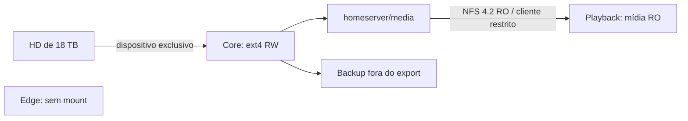

# Entrega do HD ao core e leitura NFS pela playback

O proprietário autorizou o HD de 18 TB identificado na ficha privada para
posse exclusiva pelo core: inspeção inicial somente leitura e montagem para
escrita após conferência, preservando acervo e backup. Esta etapa aplicou o
passthrough do dispositivo, o mount local e a exportação NFS de mídia RO.
A preparação posterior do Docker na playback está registrada abaixo. A
restauração e a aplicação têm aceite próprio no repositório consumidor;
recuperação automática de USB permanece pendente.

## Identidade e montagem local

Modelo, serial, UUID e capacidade coincidiram nas inspeções do host e do core.
Somente o dispositivo USB foi atribuído à VM por sua porta dedicada; o
controlador e o adaptador Ethernet USB permaneceram no host. O segundo SSD
de mídia continua desmontado e os demais discos permanecem fora desta passagem.
Não houve formatação, particionamento ou fsck corretivo.

SMART retornou `PASSED`, sem setores realocados, pendentes ou incorrigíveis e
sem erros CRC nos atributos examinados. Isso descreve essa leitura, sem
comprovar integridade de todos os arquivos ou tolerância a falha do disco.

No core, a inspeção usou dispositivo de bloco somente leitura e mount
`ro,noload`. O SHA-256 do recibo da captura coincidiu com a evidência anterior
à instalação. Foram conferidos **21 hashes de metadados e os tamanhos dos
cinco tar**. Os cinco arquivos grandes **não foram relidos por hash nesta
etapa**; permanece o alcance da verificação feita na captura original.

Depois da inspeção, o volume foi desmontado e recebeu uma montagem nova RW,
com `errors=remount-ro`, permitindo o replay normal do journal. O kernel
registrou `recovery complete`, sem erros de I/O ou ext4 observados. Paths e
permissões existentes foram preservados; o diretório de backup não faz parte
da exportação de mídia.

No `fstab` do core, foi acrescentada somente a entrada desse UUID, com
`nofail`, timeout de dispositivo de 60 segundos e campo `pass` igual a zero.
As outras entradas foram preservadas. Não há fsck automático habilitado para
esse volume. `nofail` permite o boot sem o disco; não autoriza serviços a usar
o diretório vazio subjacente. [Semântica das opções de mount no systemd](https://www.freedesktop.org/software/systemd/man/latest/systemd.mount.html).

## Export e cliente aplicados

O servidor NFS está no core, e o cliente está na playback. A configuração
permite somente NFS **4.1/4.2 sobre TCP 2049** e restringe a exportação à
identidade de rede da playback. Edge não recebe export ou mount.
O listener NFS de dados usa somente o endereço do core. `rpc.mountd` mantém
portas TCP dinâmicas internas, bloqueadas pelo firewall; a configuração não
significa que todo o guest tenha apenas um socket em escuta.

| Item | Configuração aplicada |
|---|---|
| Subdiretório exportado | Somente `homeserver/media` do HD; não a raiz do volume |
| Escrita no servidor | `ro` |
| Identidade de acesso | `all_squash`, UID/GID anônimos 1000 |
| Fronteira do export | `subtree_check`, guard `mountpoint` e `fsid=0` |
| Cliente playback | NFS 4.2, `ro,hard,noauto`, em `/srv/media-view/media` |
| Backup | Fora do namespace exportado |

`all_squash` mapeia as identidades do cliente para o usuário anônimo definido;
`ro` recusa operações de escrita no servidor. O guard `mountpoint` impede
exportar o diretório subjacente quando o mount exigido não está presente.
Ele não implementa sozinho a recuperação de USB nem a parada das aplicações.
`subtree_check` verifica a árvore exportada; mudanças de nomes e handles
precisam ser exercitadas com os consumidores reais.
[Opções oficiais do export NFS no Ubuntu](https://manpages.ubuntu.com/manpages/noble/man5/exports.5.html).

O gerador do pacote deixou `RequiresMountsFor` vazio mesmo após reload e
reexportação. Por isso, foi acrescentado um drop-in à **unit existente
`nfs-server.service` dentro do core**, com `RequiresMountsFor=/srv/external3`,
`BindsTo=srv-external3.mount`, `After=srv-external3.mount` e
`ConditionPathIsMountPoint=/srv/external3`. As dependências foram conferidas
por `systemctl show` e persistiram após reboot; nenhuma unit foi criada no host
Proxmox. Isso não comprova recuperação de perda física do USB.

Na entrega inicial, o cliente ficou com `noauto` e sem dependência de aplicação
que solicitasse o mount. A preparação do Docker descrita abaixo acrescentou
essa dependência, preservando a opção. `hard` mantém a espera por respostas
do servidor; uma falha pode bloquear I/O. A ordem de boot das VMs não
substitui disponibilidade do NFS nem os guards de mount e de scans do
consumidor.

## Provas desta etapa

Uma fixture sintética permitiu testar o servidor com o cliente deliberadamente
montado RW. As tentativas de criar, acrescentar conteúdo, alterar permissões
e remover o arquivo retornaram **`EROFS`**. Assim, o bloqueio examinado foi
imposto pelo export, além da configuração RO normal do cliente. A leitura
como UID 1000 passou; nenhum teste de escrita foi apontado ao acervo.

O namespace visível continha somente `movies`, `tv` e a fixture; o backup
não estava exposto. A fixture própria foi removida pelo core ao concluir os
testes, deixando somente `movies` e `tv` visíveis.

O reboot do core foi concluído às **23:11:20 UTC de 15/11/2026**, com mudança
do boot ID. Identidades do USB e do filesystem permaneceram iguais;
`/srv/external3` voltou RW automaticamente, NFS ficou ativo nas versões
4.1/4.2 e o drop-in manteve suas dependências. Não houve units falhadas ou
erros I/O/ext4 observados; o SHA-256 do recibo permaneceu intacto.

A playback foi **desmontada de forma limpa antes** e **remontada manualmente
RO depois**. `noauto` permanece; esse ensaio não prova recuperação automática
do cliente nem desconexão física do USB. Uma leitura como UID 1000 de **64 KiB
de um único arquivo de mídia** coincidiu por SHA-256 com o core antes e depois
do reboot. Isso não é hash do arquivo inteiro, prova global do acervo ou teste
de reprodução.

As [configurações de referência](../../infrastructure/storage/README.md)
registram o escopo da plataforma; valores reais e evidências continuam privados.

## Dependência de storage do Docker na playback

Depois da entrega NFS, Docker foi instalado **somente na playback**. O
[drop-in de referência](../../infrastructure/storage/docker-playback.storage.conf)
foi aplicado à unit existente `docker.service` dentro dessa VM dedicada.
Nenhuma unit foi criada no Proxmox.

`RequiresMountsFor=/srv/media-view/media` acrescenta as dependências
necessárias para solicitar e aguardar o mount, inclusive quando a entrada do
`fstab` contém `noauto`. `BindsTo` e `After` referenciam
`srv-media\x2dview-media.mount`, com o hífen do diretório escapado. Quando
essa unit de mount deixa de estar ativa, a dependência também para o Docker.
O vínculo afeta todo o daemon; não aplicar em um nó Docker compartilhado.
[Semântica oficial de RequiresMountsFor e BindsTo](https://www.freedesktop.org/software/systemd/man/latest/systemd.unit.html#RequiresMountsFor=).

A configuração aplicada foi relida e as dependências efetivas foram
conferidas. `systemd-analyze verify` passou ao receber explicitamente a unit
de mount gerada junto da unit Docker. Um restart do Docker ainda vazio
também passou. Depois, o Jellyfin restaurado iniciou e o reboot da playback
foi confirmado por mudança de boot ID: NFS RO, Docker e Jellyfin saudável
retornaram automaticamente, mantendo `noauto` no `fstab`.

O vínculo acompanha o estado da montagem no systemd. Um NFS `hard` pode
continuar montado quando o servidor ou seu HD desaparece; nesse caso, a
dependência não detecta a perda de saúde nem implementa reintegração
automática. O consumidor precisa conferir a identidade e o modo RO do mount,
conter scans e coordenar sua retomada. Restauração, configuração e aceites da
aplicação ficam no [runbook de playback do serviço de mídia](https://github.com/reisguilherme/homelab-mediaserver/blob/2ac092cdb3f6e57e26505fc123f13f21d87cf141/docs/runbooks/playback-nfs.md).

## Limites e próxima etapa

Essa entrega estabelece a leitura remota de mídia por um consumidor e
registra a dependência de montagem do Docker instalado posteriormente na
playback. O aceite posterior do Jellyfin, sua restauração selecionada, leitura
HTTP, decode curto por CPU e guard de mount está no runbook do consumidor.
Esses testes não comprovam automação, GPU ou conclusão da migração e da
verificação global do acervo. O núcleo ainda precisa de coordenação de falhas
entre mount, export e aplicações. Os scans permanecem suspensos com acervo parcial.

Não reutilizar o recuperador local antigo sem adaptar essa coordenação.
Falha/retorno físico do USB, nobreak, reprodução em cliente externo, carga e
comportamento das aplicações perante ausência física de mídia continuam
pendentes. Não há HA nem aceite de produção.
O backup final permanece somente no HD por decisão do proprietário, com os
limites já registrados no [estado canônico](../implementation-status.md).
Novos consumidores exigem permissões, orçamento e export próprios; esta
exportação não concede área gravável a Immich ou a outros serviços.
