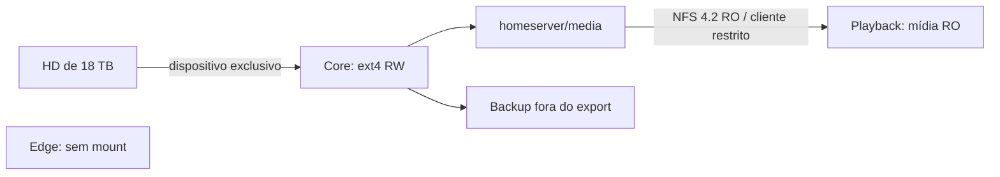

# Entrega do HD ao core e leitura NFS pela playback

O proprietário autorizou o HD de 18 TB identificado na ficha privada para
posse exclusiva pelo core: inspeção inicial somente leitura e montagem para
escrita após conferência, preservando acervo e backup. Esta etapa aplicou o
passthrough do dispositivo, o mount local e a exportação NFS de mídia RO.
A preparação posterior do Docker na playback está registrada abaixo. A
restauração e a aplicação têm aceite próprio no repositório consumidor;
recuperação automática de USB permanece pendente.

Na etapa posterior de governança, o core foi reduzido de 6 para 4 GiB após
medição, desmontagem normal do NFS na playback e desligamento gracioso.
O retorno preservou chave SSH, UUID do HD, NFS e recibo de backup; Jellyfin
voltou saudável, mantendo os 807 registros originais de UserData e os seis
novos já observados. Isso é continuidade da manutenção planejada, não ensaio
de perda física do USB. O orçamento e a VM de controle estão no
[estado canônico](../implementation-status.md#plataforma-de-controle).

## Identidade e montagem local

Modelo, serial, UUID e capacidade coincidiram nas inspeções do host e do core.
Somente o dispositivo USB foi atribuído à VM por sua porta dedicada; o
controlador e o adaptador Ethernet USB permaneceram no host. O segundo SSD
de mídia continua desmontado e os demais discos permanecem fora desta passagem.
Não houve formatação, particionamento ou fsck corretivo.

SMART retornou `PASSED`, sem setores realocados, pendentes ou incorrigíveis e
sem erros CRC nos atributos examinados. Isso descreve essa leitura, sem
comprovar integridade de todos os arquivos ou tolerância a falha do disco.

No core, a inspeção usou dispositivo de bloco somente leitura e mount
`ro,noload`. O SHA-256 do recibo da captura coincidiu com a evidência anterior
à instalação. Foram conferidos **21 hashes de metadados e os tamanhos dos
cinco tar**. Os cinco arquivos grandes **não foram relidos por hash nesta
etapa**; permanece o alcance da verificação feita na captura original.

Depois da inspeção, o volume foi desmontado e recebeu uma montagem nova RW,
com `errors=remount-ro`, permitindo o replay normal do journal. O kernel
registrou `recovery complete`, sem erros de I/O ou ext4 observados. Paths e
permissões existentes foram preservados; o diretório de backup não faz parte
da exportação de mídia.

No `fstab` do core, foi acrescentada somente a entrada desse UUID, com
`nofail`, timeout de dispositivo de 60 segundos e campo `pass` igual a zero.
As outras entradas foram preservadas. Não há fsck automático habilitado para
esse volume. `nofail` permite o boot sem o disco; não autoriza serviços a usar
o diretório vazio subjacente. [Semântica das opções de mount no systemd](https://www.freedesktop.org/software/systemd/man/latest/systemd.mount.html).

## Export e cliente aplicados

O servidor NFS está no core, e o cliente está na playback. A configuração
permite somente NFS **4.1/4.2 sobre TCP 2049** e restringe a exportação à
identidade de rede da playback. Edge não recebe export ou mount.
O listener NFS de dados usa somente o endereço do core. `rpc.mountd` mantém
portas TCP dinâmicas internas, bloqueadas pelo firewall; a configuração não
significa que todo o guest tenha apenas um socket em escuta.

| Item | Configuração aplicada |
|---|---|
| Subdiretório exportado | Somente `homeserver/media` do HD; não a raiz do volume |
| Escrita no servidor | `ro` |
| Identidade de acesso | `all_squash`, UID/GID anônimos 1000 |
| Fronteira do export | `subtree_check`, guard `mountpoint` e `fsid=0` |
| Cliente playback | NFS 4.2, `ro,hard,noauto`, em `/srv/media-view/media` |
| Backup | Fora do namespace exportado |

`all_squash` mapeia as identidades do cliente para o usuário anônimo definido;
`ro` recusa operações de escrita no servidor. O guard `mountpoint` impede
exportar o diretório subjacente quando o mount exigido não está presente.
Ele não implementa sozinho a recuperação de USB nem a parada das aplicações.
`subtree_check` verifica a árvore exportada; mudanças de nomes e handles
precisam ser exercitadas com os consumidores reais.
[Opções oficiais do export NFS no Ubuntu](https://manpages.ubuntu.com/manpages/noble/man5/exports.5.html).

O gerador do pacote deixou `RequiresMountsFor` vazio mesmo após reload e
reexportação. Por isso, foi acrescentado um drop-in à **unit existente
`nfs-server.service` dentro do core**, com `RequiresMountsFor=/srv/external3`,
`BindsTo=srv-external3.mount`, `After=srv-external3.mount` e
`ConditionPathIsMountPoint=/srv/external3`. As dependências foram conferidas
por `systemctl show` e persistiram após reboot; nenhuma unit foi criada no host
Proxmox. Isso não comprova recuperação de perda física do USB.

Na entrega inicial, o cliente ficou com `noauto` e sem dependência de aplicação
que solicitasse o mount. A preparação do Docker descrita abaixo acrescentou
essa dependência, preservando a opção. `hard` mantém a espera por respostas
do servidor; uma falha pode bloquear I/O. A ordem de boot das VMs não
substitui disponibilidade do NFS nem os guards de mount e de scans do
consumidor.

## Provas desta etapa

Uma fixture sintética permitiu testar o servidor com o cliente deliberadamente
montado RW. As tentativas de criar, acrescentar conteúdo, alterar permissões
e remover o arquivo retornaram **`EROFS`**. Assim, o bloqueio examinado foi
imposto pelo export, além da configuração RO normal do cliente. A leitura
como UID 1000 passou; nenhum teste de escrita foi apontado ao acervo.

O namespace visível continha somente `movies`, `tv` e a fixture; o backup
não estava exposto. A fixture própria foi removida pelo core ao concluir os
testes, deixando somente `movies` e `tv` visíveis.

O reboot do core foi concluído às **23:11:20 UTC de 15/11/2026**, com mudança
do boot ID. Identidades do USB e do filesystem permaneceram iguais;
`/srv/external3` voltou RW automaticamente, NFS ficou ativo nas versões
4.1/4.2 e o drop-in manteve suas dependências. Não houve units falhadas ou
erros I/O/ext4 observados; o SHA-256 do recibo permaneceu intacto.

A playback foi **desmontada de forma limpa antes** e **remontada manualmente
RO depois**. `noauto` permanece; esse ensaio não prova recuperação automática
do cliente nem desconexão física do USB. Uma leitura como UID 1000 de **64 KiB
de um único arquivo de mídia** coincidiu por SHA-256 com o core antes e depois
do reboot. Isso não é hash do arquivo inteiro, prova global do acervo ou teste
de reprodução.

As [configurações de referência](../../infrastructure/storage/README.md)
registram o escopo da plataforma; valores reais e evidências continuam privados.

## Dependência de storage do Docker na playback

Depois da entrega NFS, Docker foi instalado **somente na playback**. O
[drop-in de referência](../../infrastructure/storage/docker-playback.storage.conf)
foi aplicado à unit existente `docker.service` dentro dessa VM dedicada.
Nenhuma unit foi criada no Proxmox.

`RequiresMountsFor=/srv/media-view/media` acrescenta as dependências
necessárias para solicitar e aguardar o mount, inclusive quando a entrada do
`fstab` contém `noauto`. `BindsTo` e `After` referenciam
`srv-media\x2dview-media.mount`, com o hífen do diretório escapado. Quando
essa unit de mount deixa de estar ativa, a dependência também para o Docker.
O vínculo afeta todo o daemon; não aplicar em um nó Docker compartilhado.
[Semântica oficial de RequiresMountsFor e BindsTo](https://www.freedesktop.org/software/systemd/man/latest/systemd.unit.html#RequiresMountsFor=).

Na entrega inicial, a configuração aplicada foi relida e as dependências efetivas foram
conferidas. `systemd-analyze verify` passou ao receber explicitamente a unit
de mount gerada junto da unit Docker. Um restart do Docker ainda vazio
também passou. Depois, o Jellyfin restaurado iniciou e o reboot da playback
foi confirmado por mudança de boot ID: NFS RO, Docker e Jellyfin saudável
retornaram automaticamente, mantendo `noauto` no `fstab`.

O vínculo acompanha o estado da montagem no systemd. Um NFS `hard` pode
continuar montado quando o servidor ou seu HD desaparece; nesse caso, a
dependência não detecta a perda de saúde nem implementa reintegração
automática. O consumidor precisa conferir a identidade e o modo RO do mount,
conter scans e coordenar sua retomada. Restauração, configuração e aceites da
aplicação ficam no [runbook de playback do serviço de mídia](https://github.com/reisguilherme/homelab-mediaserver/blob/2ac092cdb3f6e57e26505fc123f13f21d87cf141/docs/runbooks/playback-nfs.md).

## Disco dedicado para transcode

O proprietário autorizou depois um disco virtual **novo de 32 GiB em
`local-lvm`**, conectado como `scsi1` somente à playback. Foi formatado ext4 e
montado por UUID em `/srv/transcode`. A raiz e o marcador de identidade são
de root; somente `data/` é a área RW do UID 1000. O Jellyfin recebe essa
subpasta em `/transcode` e o marcador RO, mantendo mídia RO e limite de 3 GiB
de RAM. O tmpfs provisório de 512 MiB deixou de ser o destino de transcode.

As provas reais conferiram guard correto, recusa de mount ausente e UUID
divergente, escrita UID 1000 na área temporária e proteção RO do marcador.
Um encode CPU `libx264` de 10,01 s/720p terminou em 1,149 s, com 281.888 bytes,
sem mudança em `UserData`; só a saída de teste própria foi removida. Isso não
mede dez reproduções ou operação contínua. Um reboot posterior confirmou o
retorno do SSD por UUID, do NFS RO e do Docker, com readmissão explícita.
O filesystem limita essa área, mas o uso físico do thin pool continua exigindo
acompanhamento. Nenhum disco do acervo foi formatado.

## Admissão obrigatória de storage

O coordenador implantado publica no SSD da playback uma lease vinculada
ao boot do guest, com validade máxima de **45 segundos**. O consumidor exige
essa autorização e recusa ou para quando ela está ausente, inválida ou expirada. A
plataforma coordena a prova de storage; mount presente não significa disco
saudável. Um probe pendente não deve originar novos probes concorrentes.

Uma falha mantém `HOLD`. `resume` é ação explícita e depende de prova nova;
reconectar o HD não basta para readmitir o consumidor. O coordenador não
executa start, mas a lease renovada pode permitir reinício pela política
Docker `unless-stopped`. Uma parada manual pelo Docker permanece respeitada.

O consumidor iniciou saudável com lease obrigatória. Em expiração sintética,
o processo filho recebeu TERM em **11,502 s**; o tempo observado não é RTO
garantido. No HOLD real, HTTP ficou indisponível e não havia processo Jellyfin.
Um `docker stop` manual permaneceu respeitado após READY; somente start
explícito voltou a deixar o serviço saudável. O ensaio não desligou o HD.

O cron existente executa watch de **58 s**, com deadline de probe de **15 s**
e TTL máximo de **45 s**. A janela inicial mais curta deixou um intervalo na
passagem ao cron e gerou HOLD indevido; a cadência foi corrigida. Disputa de
lock retorna **75**, não confirmação de sucesso. Conferir o estado antes de
repetir uma readmissão.

**Reboot exige readmissão, sem retorno integral desassistido.** Lease de outro
boot deve ser recusada; prova nova e `resume` explícito precisam preceder a
retomada permitida pelo Docker. O ensaio com SSD/lease passou: a autorização do
boot anterior foi recusada, a chave SSH permaneceu estável e Jellyfin voltou
saudável após prova nova. Catálogo, 807 históricos originais e seis adições
observadas foram preservados; SQLite passou no quick_check.
Após reboot do Proxmox, auditar o estado do coordenador antes de readmitir;
esse limite faz parte do desenho atual.

A entrega não prevê montagem/reparo automático, reanexação USB, reboot
automático ou retomada com identidade incerta. I/O preso em NFS `hard`, energia
do HD e reintegração física continuam com limites próprios. Não remover um
`HOLD` ou renovar autorização apenas para obter saúde aparente.

## Limites e próxima etapa

Essa entrega estabelece a leitura remota de mídia por um consumidor e
registra a dependência de montagem do Docker instalado posteriormente na
playback. O aceite posterior do Jellyfin, sua restauração selecionada, leitura
HTTP, decode curto por CPU e guard de mount está no runbook do consumidor.
Esses testes não comprovam automação, GPU ou conclusão da migração e da
verificação global do acervo. O núcleo ainda precisa de coordenação de falhas
entre mount, export e aplicações. Os scans permanecem suspensos com acervo parcial.

Não reutilizar o recuperador local antigo sem adaptar essa coordenação.
Falha/retorno físico do USB, nobreak, reprodução em cliente externo, carga e
comportamento das aplicações perante ausência física de mídia continuam
pendentes. Não há HA nem aceite de produção.
O backup final permanece somente no HD por decisão do proprietário, com os
limites já registrados no [estado canônico](../implementation-status.md).
Novos consumidores exigem permissões, orçamento e export próprios; esta
exportação não concede área gravável a Immich ou a outros serviços.
