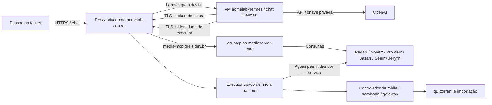

# Assistente de mídia: Hermes e arr-mcp

Data: 16/11/2026. Estado: desenho preparado; implantação e aceites pendentes.
Escopo corrigido pelo proprietário: **somente mediaserver, sem controles do
Proxmox no agente**. A VM nova continua sendo o destino do Hermes; provisioná-la
é trabalho da plataforma, não uma capacidade do assistente.

## Intenção e resultado esperado

Conversar com um assistente privado para encontrar mídia, escolher a edição e
qualidade, confirmar o pedido, acompanhar download/importação e administrar os
serviços de mídia. O resultado de uma operação precisa refletir o estado real:
pedido aceito, aguardando admissão, baixando, importando e disponível são estados
diferentes. O assistente deve explicar bloqueios de storage ou manutenção.

Exemplo de conversa:

```text
Pessoa: Baixe este filme.
Hermes: Encontrei estes títulos/anos. Qual é o desejado?
Pessoa: O primeiro, 1080p, áudio português, até 8 GiB.
Hermes: Mostra título/ID, perfil, edição, release, tamanho e destino.
Interface: Solicita confirmação humana desses parâmetros.
Hermes: Pedido recebido; informa a admissão e acompanha a operação pelo ID.
Hermes: Confirma a disponibilidade no Jellyfin somente após observá-la.
```

Também entram no escopo consultas de saúde, biblioteca e fila, ações específicas
de pausa/retomada e rotação de credenciais dos aplicativos quando solicitadas.
Não executar uma rotação durante a instalação só para testar o fluxo.

O chat é inicialmente **exclusivo do proprietário**, com uma conta humana e uma
identidade MCP, sem acesso automático de usuários Jellyfin. Esta é uma escolha
de implementação coerente com o pedido pessoal; compartilhar exige outro
contrato de papéis. Biblioteca visível no Jellyfin não concede uso do assistente.

Não entram: criar/controlar VMs, ACLs Proxmox, shell remoto genérico, gestão de
discos, K3s, GPU, exposição WAN, mensagens a terceiros, limpeza automática de
mídia e retomada em massa da fila antiga. Não alterar a autenticação Proxmox ou
Órbita, contas SSH ou usuários comuns Jellyfin como efeito colateral.

## Decisões do proprietário e escolhas de implementação

O proprietário escolheu arr-mcp na core, Hermes em VM própria, modelo externo
com chave da API OpenAI e acesso privado. Criou os nomes `hermes.greis.dev.br`
e `media-mcp.greis.dev.br`; ambos resolveram para o controle Tailscale na
conferência de 16/11. Isso comprova DNS, não a instalação dos serviços.

As escolhas seguintes são propostas técnicas do implementador:

- Interface web nativa do Hermes, acessível por card no Órbita. Construir outro
  chat no portal duplicaria sessões, streaming e confirmações sem necessidade.
- arr-mcp para consultas; executor de mídia tipado para alterações que precisam
  preservar a admissão e os limites existentes. Conceder todas as escritas do
  arr-mcp seria mais curto, mas contornaria garantias que o projeto já aplica.
- Um chat/operação de modelo por vez, sem Chromium, modelo local ou subagentes
  paralelos. O supervisor acompanha trabalhos com consultas determinísticas;
  não chama o modelo a cada atualização de progresso.
- Repositórios separados: plataforma contém infraestrutura/contrato;
  mediaserver contém arr-mcp e executor de mídia; `homelab-assistant` contém
  configuração, instruções e implantação Hermes. Nome do terceiro repo é
  proposta; publicar não inclui `.env`, memória, conversas ou bancos.

## Topologia e acessos



- `https://hermes.greis.dev.br/`: interface autenticada do Hermes.
- `https://media-mcp.greis.dev.br/`: UI administrativa autenticada do arr-mcp.
- `https://media-mcp.greis.dev.br/mcp`: Streamable HTTP MCP, bearer exclusivo
  de leitura. Não transportar tokens em query string.
- `/operations/mcp` no mesmo nome: executor separado, autenticação e escopos
  próprios. Não encaminhar essa rota ao arr-mcp upstream.
- O wildcard privado existente cobre os dois nomes. Renovação permanece DNS-01
  manual com alertas; adicionar nomes não automatiza a renovação.
- Preservar Jellyfin LAN em `http://192.168.1.20:8096`, sem prefixo, e todos os
  dez vhosts privados existentes. Edge permanece desligada.

A VM Hermes não precisa de uma identidade Tailscale própria para servir o chat:
o proxy da control faz esse acesso. Para cliente MCP, usar o mesmo hostname TLS
com resolução privada explícita na VM e listener interno do proxy restrito ao
IP do Hermes. Acesso interno não depende de rota para o IP Tailscale.
Conferir SNI/Host, origem e certificados sem `insecure` ou `skip_verify`.

Permitir apenas control → Hermes:9119 e core:6060/porta do executor, Hermes →
listener MCP privado e saída necessária a DNS/NTP/API OpenAI. Negar ao Hermes
SSH e APIs Proxmox, sockets Docker e acesso direto aos painéis de escrita.
Regras e identidades reais ficam em configuração privada. O acesso de uma
pessoa à porta 443 da tailnet não substitui autenticação dos aplicativos.

## Recursos e provisionamento

Medição somente leitura: host com 15,49 GiB utilizáveis e aproximadamente
3,04 GiB disponíveis, sem swap em uso ou pressão de memória na amostra. São
valores ociosos, sem prova de pico simultâneo. Guests configurados somam
11 GiB incluindo a edge parada; o contrato reserva 3 GiB ao host.

| Componente | Orçamento inicial | Observação |
|---|---|---|
| VM `homelab-hermes` | 2 vCPU, quota de 1 CPU, 1408 MiB RAM | Cabe na política vigente, contando a edge parada |
| Hermes container | 1024 MiB, sem browser/subagentes paralelos | Hipótese de piloto; inclui modelo remoto |
| Disco novo Hermes | qcow2 de 24 GiB no storage `local` existente | SSD; não usar discos de mídia nem o thin pool quase comprometido |
| arr-mcp na core | 256 MiB, 0,5 CPU | IMDb e webhooks desabilitados; medir pico real |
| Executor de mídia | orçamento inicial de 128 MiB na core | Reusar controlador e limitar concorrência |

A documentação Hermes informa mínimo de 1 GB para o container, excluindo SO.
Por isso 1408 MiB é um piloto restrito, não promessa de estabilidade. Aceitar
somente após ensaio de chat + catálogo + monitoramento simultâneo à reprodução,
sem OOM, crescimento contínuo, swap ativo ou regressão material de reprodução.
Falha mantém o agente desativado e exige redimensionamento explícito; não reduzir
silenciosamente memória das VMs atuais nem a reserva do host.

`local-lvm` tem apenas cerca de 4,80 GiB nominais disponíveis após a reserva
escolhida. `local` tinha 84,36 GiB livres; 24 GiB preenchidos deixariam cerca de
60 GiB. Acrescentar o tipo `images` à configuração existente do `local`,
preservando seus outros tipos. Importar a imagem Ubuntu já validada para o novo
disco e ampliar somente esse disco virtual. Não formatar nem montar um disco
físico, reutilizar volume antigo ou reaplicar o bootstrap geral.

VMID/IP candidatos devem ser revalidados e reservados imediatamente antes da
criação; conflito aborta. Usar QGA, chave SSH restrita ao operador, autostart
posterior à control/core e tags de plataforma/assistente. O agente não recebe
essa chave. A infraestrutura da VM fica no repo platform, sem ampliar a API do
portal para criar VMs por chat.

## Versões e instalação

- arr-mcp `v2.2.1`, commit
  `0f28a088bc42ce7fba4e7ad557b2292f9ab09727`. Imagem
  `ghcr.io/bardesss/arr-mcp:2.2.1` fixada ao digest de índice
  `sha256:52267602cdc0847927608bea4c5e7196fc586edda199bde91fa5fe75911827fa`,
  plataforma `linux/amd64`. Metadados OCI conferem versão e commit; imagem ainda
  não executada. Não executar `latest` ou instalador remoto sem revisão.
- Hermes `v0.23.2`, commit
  `ae2a81ccc00e9b7c06301523e5bb09608397149c`.
  Imagem `nousresearch/hermes-agent:v0.23.2` fixada ao digest de índice
  `sha256:d6746a084e9341baada483e3d6210444d3c1aeb7c130f0915150065fb2851459`,
  plataforma `linux/amd64`. Digest foi consultado; imagem ainda não executada.
- Estado do arr-mcp no SSD em `/srv/appdata/arr-mcp`; estado Hermes em volume
  próprio da VM. Nenhum recebe mount de `/srv/data`, acervo ou socket Docker.
- Compose separado do monólito histórico. Reivindicar a primeira conta arr-mcp
  por loopback antes de publicar o proxy. A UI exige senha de pelo menos
  12 caracteres; gerar uma credencial privada nova sem alterar as anteriores.
- Chave OpenAI inserida pelo proprietário na configuração privada do Hermes,
  depois de haver HTTPS/autenticação verificados. Não pedir segredo no chat.
  `.env` privado persiste a chave; não encaminhá-la a subprocessos MCP ou logs.
- Propor inicialmente `gpt-6-luna` na API Responses, conforme disponibilidade
  real da conta. Conferir transporte da versão Hermes antes de usar. Sem chave
  e resposta válida da API, não declarar o chat funcional. Não habilitar
  fallback automático para modelo mais caro.

## Autorização e confirmação humana

Separar consulta, proposta e execução. O arr-mcp recebe token de leitura do
Hermes, escritas desabilitadas por serviço, API de gestão desligada e hosts/
proxies explicitamente permitidos. Sua confirmação upstream entrega um token
ao modelo, que pode devolvê-lo sozinho; isso não comprova confirmação humana.

O executor de mídia guarda a intenção normalizada, ator, parâmetros, revisão,
prazo, chave de idempotência e estado. Nenhuma ferramenta aceita um booleano
`approved` nem token de aprovação fornecido pelo modelo. O MCP solicita
confirmação por `elicitation/create` (form) ao runtime Hermes; a resposta da
pessoa deve voltar diretamente ao executor, sem entrar no contexto do modelo.
Usar campo obrigatório `decision` com enum `allow_once`/`deny`, sem default;
somente `action=accept` **e** `decision=allow_once` autorizam. `accept` sozinho
significa que o formulário foi enviado, não que a ação foi aceita. Vincular a
resposta à chamada RPC em curso, intenção, hash, ator e prazo no servidor.
Cancelar, pular, expirar ou executar em modo desassistido significa recusar.
O código upstream foi revisado (`agent/tool_executor.py`,
`tools/mcp_tool_sampling.py` e `tools/mcp_elicitation_form.py`); o caminho ainda
precisa de teste interativo antes de habilitar escrita.

Essa fronteira confia no runtime Hermes autenticado para transportar a decisão
da pessoa; não resiste a uma VM Hermes inteiramente comprometida. Tokens limitam
o dano ao contrato de mídia. Não equiparar prompt, nome de perfil ou cabeçalho
de identidade a login humano. Se a versão não conseguir conservar confirmação
interativa separada do modelo, usar uma página de aprovação autenticada do
executor, vinculada ao mesmo ID, sem relaxar a exigência.

Recusar instruções de operação embutidas em títulos, releases, metadados,
subtítulos ou logs. Não habilitar shell, HTTP genérico, filesystem irrestrito,
instalação de skills ou escrita na configuração pelo modelo. O proprietário
continua podendo administrar a configuração na interface autenticada.

## Operações de mídia e estados

Ferramentas pequenas, com schemas fechados e limite de retorno:

| Grupo | Capacidade | Condição de escrita |
|---|---|---|
| Consulta | saúde, catálogo, títulos, perfis, releases, fila, histórico | Token de leitura; dados sanitizados |
| Pedido | propor mídia/qualidade, confirmar, submeter e acompanhar | Confirmação humana e admissão pelo controlador |
| Fila | pausa/retomada de hash ou pedido específico | Confirmar alvo; capacidade/lease atual para retomar |
| Credenciais | propor rotação de uma conta em um aplicativo | Confirmar identidade; executor gera e guarda segredo |

O primeiro contrato administra mídia, fila e credenciais. Reinício de processos
ou containers continua no Órbita, sem ser exposto ao Hermes nesta entrega; isso
evita acrescentar SSH, Docker ou QGA ao executor. O agente pode diagnosticar e
indicar o card correto quando o serviço precisar de reinício.

Não expor endpoints universais `call_api`, `exec`, `approve`, CRUD de arquivo
ou escrita arbitrária em configuração. Não habilitar `safe_write` completo do
arr-mcp: essa categoria também move arquivos, inicia buscas, imports e scans.

Fluxo de aquisição:

1. Resolver título/ano e IDs; consultar biblioteca para evitar duplicidade.
2. Confirmar com a pessoa perfil, resolução, idiomas, edição, limite de tamanho
   e abrangência de série/temporadas. Sem disponibilidade, relatar a pendência.
3. Consultar releases e mostrar candidato compatível com rejeições e riscos;
   nenhum magnet ou URL externa arbitrária é aceito diretamente do modelo.
4. Persistir plano com IDs, release/indexer, destino lógico, tamanho, perfil e
   versão observada. Mudança material invalida a confirmação.
5. Após confirmação, revalidar capacidade, lease e manutenção. Usar o fluxo
   existente request → reserva → permit → grab. Não dar ao arr-mcp acesso ao
   proxy administrativo qBit para contornar o gateway.
   A seleção de release fica persistida e deve ser respeitada pelo worker;
   criar apenas um pedido Seerr e deixar outra release ser escolhida não cumpre
   a confirmação. Se o candidato deixar de servir, solicitar novo aceite.
6. Reconciliar a mesma intenção após timeout; não repetir a aquisição quando o
   efeito for incerto. Acompanhar hash/request/import/Jellyfin por IDs.
7. Informar disponibilidade apenas quando observada. Não liberar scans globais
   enquanto o acervo parcial mantiver essa contenção.

O adapter qBit upstream não é compatível diretamente com o gateway atual:
usa endpoints não permitidos e grava sem os permits/categorias exigidos.
Leituras de fila devem vir do controlador ou de um adapter RO explicitamente
filtrado. A fila legada não é toda representada pela API de requests atual;
mostrar essa diferença e permitir ações somente com alvo reconhecido.

A API de mídia está parada e gateway/worker em manutenção na última observação.
Habilitar novos pedidos exige readmissão controlada, mantendo os torrents antigos
parados. Se não houver separação confiável entre novos pedidos e retomada em
massa, conservar bloqueio e implementar essa separação antes do aceite.

## Rotação de credenciais

O arr-mcp não troca a senha de usuário no aplicativo; editar sua configuração
somente troca a credencial que ele usa. Implementar adapters específicos para
Radarr, Sonarr, Prowlarr, Bazarr, qBittorrent e a conta administrativa Jellyfin.
Seerr usa a origem de autenticação Jellyfin: atualizar dependências vinculadas,
sem prometer senha local independente. Grafana, Órbita, Proxmox, Hermes, arr-mcp
e SSH ficam fora da rotação pelo assistente. Usuários comuns Jellyfin ficam fora
do contrato inicial; não redefinir a biblioteca inteira de contas.
O alvo exato (aplicativo, conta, dependências) deve ser
mostrado antes da confirmação. Aplicativos vinculados ao Jellyfin/Seerr precisam
identificar a origem da conta; não inventar uma conta local independente.

Gerar senha no executor, guardar de forma privada, atualizar referências de
integração e verificar login/logout. Não colocar senha, hash reutilizável ou API
key em argumentos de ferramentas, journal genérico, chat, telemetria ou Git.
Uma tela humana autenticada de revelação única ou recibo privado no destino
operacional entrega a nova senha; o modelo recebe apenas sucesso e referência.
Não usar formulários MCP para pedir senhas: elicitation não é um canal para
coletar credenciais. Hermes desta versão também não implementa elicitation URL.
Falha de atualização de dependência fica como operação incompleta/reconciliável,
sem rollback cego ou alegação de sucesso parcial como conclusão.

## Entrega e critérios de aceite

1. Base privada: VM, limites, Compose, arr-mcp RO, proxy, cards e telemetria;
   login/HTTPS, autenticação MCP e negações de rede testadas.
2. Chat real com chave configurada pelo proprietário: uma consulta de catálogo,
   sem expor credenciais nem disparar download; schemas restritos e metadados
   tratados como dados. Medir RAM/CPU durante consulta e reprodução.
3. Executor: testes em fixtures de confirmação/cancelamento/expiração/replay,
   mudança de parâmetros, efeito incerto, storage indisponível, HOLD manual,
   permissões e acesso anônimo. Reusar os controles existentes, sem duplicar
   scheduler ou fingir que 202 significa download concluído.
4. Piloto de mídia autorizado: pedido definido pela pessoa, confirmação, admissão,
   progresso, importação e leitura no Jellyfin. Preservar a fila antiga e o acervo.
5. Administração: conta de teste para rotação e dependências, segredos ausentes
   em logs, alvo errado recusado. Não testar alteração de senha em usuários reais
   por conveniência. Rotação que exija restart depende de operação autorizada do
   executor do serviço; se o adapter não conseguir concluí-la com seus próprios
   privilégios, não começar a mudança e explicar a dependência.

As etapas são dependências de entrega, não mudança para um assistente somente
leitura definitivo. Consulta, aquisição, fila e administração precisam de aceite
próprio; não declarar o pedido inteiro concluído só porque a UI responde.

Registrar estado da VM, container, memória real/pico, falhas MCP, pendências de
admissão, intenções em estado incerto e expiração TLS no painel. Sem labels de
alta cardinalidade com títulos, nomes de usuário, URLs de download ou tokens.
Histórico e memória do Hermes podem conter hábitos de uso; ficam privados.

Reversão: parar Hermes/executor, revogar seus tokens e remover apenas os novos
vhosts/regras/cards. Não excluir VM/disco ou estado automaticamente, nem alterar
os serviços antigos. Pedidos já submetidos são reconciliados antes de qualquer
nova ação. Backup/configurações anteriores e origens do acervo são preservados.

## Fontes e limites da evidência

- [arr-mcp: ferramentas](https://github.com/bardesss/arr-mcp/blob/0f28a088bc42ce7fba4e7ad557b2292f9ab09727/docs/tools.md),
  [escritas](https://github.com/bardesss/arr-mcp/blob/0f28a088bc42ce7fba4e7ad557b2292f9ab09727/docs/writes.md)
  e [confirmação](https://github.com/bardesss/arr-mcp/blob/0f28a088bc42ce7fba4e7ad557b2292f9ab09727/src/core/confirm.ts).
- [Hermes v0.23.2](https://github.com/NousResearch/hermes-agent/releases/tag/v0.23.2),
  [dashboard](https://github.com/NousResearch/hermes-agent/blob/v0.23.2/website/docs/user-guide/features/web-dashboard.md),
  [MCP](https://github.com/NousResearch/hermes-agent/blob/v0.23.2/website/docs/user-guide/features/mcp.md)
  e [recursos Docker](https://github.com/NousResearch/hermes-agent/blob/v0.23.2/website/docs/user-guide/docker.md).
- [API OpenAI: GPT-6 Luna](https://developers.openai.com/api/docs/models/gpt-6-luna).
- Plataforma: `services/control/app.py`, `operations.py`, `runtime.py` e
  [governança](../../runbooks/platform-governance.md). Esses executores Proxmox
  **não** serão oferecidos ao Hermes neste escopo.
- Mediaserver: `api/downloads.py`, `worker/acquisition.py`,
  `worker/request_profiles.py`, `gateway/app.py` e `core-storage-guard.py`.

Pesquisa upstream e inspeção do host não comprovam operação do Hermes, segurança
fim a fim, desempenho sob dez reproduções, importação de mídia nova ou rotação
real de credenciais. Cada afirmação de entrega exige recibo sanitizado próprio.
